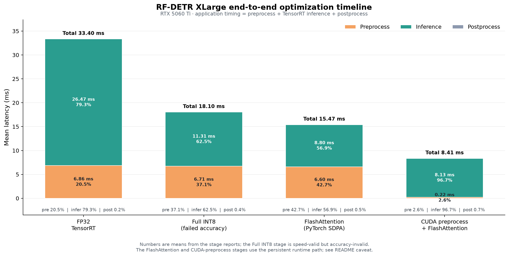

# RF-DETR XLarge TensorRT 量化实验

本仓库记录 RF-DETR XLarge 从 PyTorch 导出、FP32 TensorRT 基线、计算图分析，到 encoder 和 decoder 选择性 INT8 量化的完整过程。模型文件、TensorRT engine、COCO 逐图预测和大体积实验产物保留在本地，但默认不会进入 Git。



图中每根柱子都是一次端到端单图调用的平均耗时，横轴按优化顺序排列，纵轴是毫秒；柱子从下到上依次是前处理、TensorRT 推理、后处理。每个可读的色块内同时给出该阶段的绝对时间和它占总时间的百分比，柱子下方再次列出 `pre / infer / post` 占比，便于区分“模型变快”和“数据搬运变快”。FP32 基线约 `33.40 ms`，最初全量 Conv+MatMul INT8 降到 `18.10 ms`，但 mAP 只有 `0.12592`，因此图中标记为 `failed accuracy`；FlashAttention 把推理段降到约 `8.80 ms`，CUDA fused 前处理再把前处理从约 `6.60 ms` 降到约 `0.22 ms`，总时间约 `8.41 ms`。这些数字来自各阶段报告的 mean benchmark；FlashAttention 和 CUDA 前处理使用 persistent runtime，早期 FP32/全量 INT8 数据使用当时的 C++ benchmark 配置，不能把它们当成同一 runtime 参数下的严格 A/B 测试，精确命令和 P95 见对应报告。

| 阶段 | 前处理 | TensorRT 推理 | 后处理 | 总计 | 精度状态 | 数据来源 |
|---|---:|---:|---:|---:|---|---|
| FP32 TensorRT | 6.855 ms | 26.474 ms | 0.071 ms | 33.400 ms | mAP 0.581367 | [FP32 基线](BASELINE.md) |
| 最初全量 Conv+MatMul INT8 | 6.712 ms | 11.314 ms | 0.070 ms | 18.097 ms | mAP 0.12592，失败 | [INT8 报告](tensort_quant/INT8_QUANTIZATION_REPORT.md) |
| FlashAttention（PyTorch SDPA，FP16 attention） | 6.60 ms | 8.80 ms | 0.07 ms | 15.47 ms | mAP 0.580391 | [阶段二报告](stage2_advanced_opt/STAGE2_EXPERIMENT_REPORT.md) |
| CUDA fused 前处理 + FlashAttention | 0.22 ms | 8.13 ms | 0.06 ms | 8.41 ms | mAP 0.580853 | [阶段三报告](stage3_accelerate_process/README.md) |

## 当前方案

当前量化主线方案是：

```text
PyTorch RF-DETR XLarge
  → FP32 ONNX
  → encoder SmoothQuant（256 张 COCO 校准图）
  → decoder Linear SmoothQuant（同一组 256 张校准图）
  → TensorRT engine
```

在这条保精度量化主线上，阶段二提供独立 CUTLASS FlashAttention plugin，阶段三提供 CUDA fused 前处理；两者是运行时和计算图加速层，可以组合到同一端侧 pipeline。CUTLASS plugin 已通过 COCO 全量精度门禁，并可嵌入 TensorRT engine，避免部署时依赖 libtorch 和外部 plugin 查找。

对应本地模型和 engine：

```text
tensorrt_quant_decoder/artifacts/smoothquant_all_linear_256/
```

完整 COCO 结果：mAP@[0.50:0.95] = **0.580280**。固定 encoder SmoothQuant、decoder FP32 基线为 0.580251，因此 decoder SmoothQuant 的精度变化约为 **+0.000029**。当前应用级 TensorRT 推理均值为 18.710 ms；decoder 量化的主要收益是模型权重压缩，速度收益目前不稳定。

## 实验逻辑

### 1. PyTorch → FP32 ONNX

```bash
conda activate torch
python python_infer/export_rfdetr_xlarge.py
```

`python_infer/export_rfdetr_xlarge.py` 使用 RF-DETR 官方导出接口生成 `python_infer/output/rfdetr-xlarge.onnx`。输入固定为 `1×3×700×700`，输出为 `dets` 和 `labels`。

### 2. FP32 TensorRT 推理基线

```bash
conda activate TensorRT
trtexec --onnx=python_infer/output/rfdetr-xlarge.onnx \
  --saveEngine=model_xlarge.engine --skipInference
```

`tensort_quant/build_int8_engine.py` 是可复用的 engine 构建封装；`tensorrt_convert/onnx2engine_fp.py` 是历史 FP32 转换脚本。`evaluate_coco_tensorrt.py` 负责统一预处理、TensorRT 推理、后处理和 COCOeval：

```bash
conda activate torch
python evaluate_coco_tensorrt.py --engine model_xlarge.engine \
  --output coco_predictions.json --report coco_baseline.json
```

### 3. 全计算图分析

```bash
conda activate TensorRT
trtexec --loadEngine=tensort_quant/artifacts_xlarge_smoothquant_256/rfdetr-xlarge-smoothquant-256.engine \
  --iterations=200 --warmUp=200 --profilingVerbosity=detailed --dumpProfile \
  --exportProfile=tensorrt_quant_decoder/compute_graph_analysis/baseline_profile.json

conda activate torch
python tensorrt_quant_decoder/analyze_compute_distribution.py
```

该阶段输出 encoder、decoder、head 的理论 Dense FLOPs、TensorRT 融合 layer 时间、CSV 和图表，详见 [计算量报告](tensorrt_quant_decoder/compute_graph_analysis/COMPUTE_DISTRIBUTION_REPORT.md)。

### 4. Encoder 量化

`tensort_quant/quantize_int8.py`：基于 ONNX Runtime 的静态 Q/DQ PTQ，支持 MinMax、Percentile、显式节点选择和校准 cache。

```bash
conda activate torch
python tensort_quant/quantize_int8.py \
  --model python_infer/output/rfdetr-xlarge.onnx \
  --images /home/rton/val2017/val2017 \
  --output <output.onnx> --manifest <manifest.json> \
  --calibration-count 256 --quantize-ops MatMul
```

`tensort_quant/modelopt_smoothquant.py`：使用 ModelOpt 对 DINOv2 encoder Linear 的输入和权重执行 SmoothQuant，再导出 ONNX。当前推荐 encoder 产物为 `artifacts_xlarge_smoothquant_256`。

`tensort_quant/percentile_clip_encoder.py`：复用 encoder 权重 Q/DQ 图，只重统计 activation 的 p99.99 scale，避免 XLarge 直方图校准的内存开销。

### 5. Encoder 误差诊断

```bash
conda activate TensorRT
python tensort_quant/error_analysis_Conv_MatMul_compare/analyze_quant_error.py

conda activate torch
python tensort_quant/error_analysis_encoder_compare/analyze_encoder_algorithms.py
python tensort_quant/error_analysis_encoder_compare/analyze_weight_distributions.py
python tensort_quant/error_analysis_encoder_compare/analyze_activation_input_distributions.py
```

`analyze_quant_error.py` 使用 Polygraphy 的 `OnnxrtRunner`、`TrtRunner`、`Comparator` 和 `ModifyOutputs`，定位共同中间张量的误差传播。三个 encoder 分布脚本分别分析逐层算法差异、权重分布和输入激活分布。

Encoder 阶段报告入口：

| 报告 | 内容 |
|---|---|
| [FINAL_QUANTIZATION_REPORT.md](tensort_quant/FINAL_QUANTIZATION_REPORT.md) | 全量 Conv+MatMul INT8 失败原因、encoder 算法比较、速度和部署结论 |
| [STAGE_REPORT_ENCODER.md](tensort_quant/error_analysis_encoder_compare/STAGE_REPORT_ENCODER.md) | encoder 逐层误差、权重分布、输入激活误差和图表解读 |
| [INT8_QUANTIZATION_REPORT.md](tensort_quant/INT8_QUANTIZATION_REPORT.md) | 基础 PTQ、Conv-only 结果、COCO 精度和 TensorRT 延迟 |
| [PTQ_EXPERIMENT_REPORT.md](tensort_quant/PTQ_EXPERIMENT_REPORT.md) | Conv、DINO FFN、QKV/QKVO、decoder 和 SmoothQuant 分组实验 |
| [Polygraphy 诊断说明](tensort_quant/error_analysis_Conv_MatMul_compare/README.md) | 全量量化的逐层中间张量和最终输出误差定位 |

报告中引用的 encoder 图表位于 `tensort_quant/error_analysis_encoder_compare/`；全量 MinMax 和 SmoothQuant 的 Polygraphy 图表分别位于 `error_analysis_Conv_MatMul_compare/` 和 `error_analysis_Conv_MatMul_compare_smoothquant/`。

### 6. Decoder 量化

```bash
conda activate torch
python tensorrt_quant_decoder/quantize_decoder_scope.py --scope self_qkv

# 当前推荐的组合方案：encoder SQ256 + decoder Linear SmoothQuant
python tensorrt_quant_decoder/smoothquant_decoder.py \
  --scope all_linear --calibration-count 256

conda activate TensorRT
python tensort_quant/build_int8_engine.py \
  --onnx tensorrt_quant_decoder/artifacts/smoothquant_all_linear_256/rfdetr-xlarge-decoder-smoothquant-all-linear-256.onnx \
  --engine tensorrt_quant_decoder/artifacts/smoothquant_all_linear_256/rfdetr-xlarge-decoder-smoothquant-all-linear-256.engine
```

`quantize_decoder_scope.py` 用显式 decoder 节点名做 MinMax PTQ，D1～D9 用于敏感性实验；`smoothquant_decoder.py` 保留 encoder SQ256 配置，同时对选定 decoder Linear 的输入和权重启用 ModelOpt SmoothQuant。LayerNorm、残差、Softmax、deformable sampling、GridSample 和 detection head 保持原精度。

```bash
conda activate torch
python tensorrt_quant_decoder/summarize_decoder_experiments.py
```

该脚本汇总完整 COCO mAP、延迟、engine 大小并生成 decoder 敏感性图表。详细说明见 [decoder 实验报告](tensorrt_quant_decoder/DECODER_EXPERIMENT_REPORT.md) 和 [decoder 方案](tensorrt_quant_decoder/DECODER_OPTIMIZATION_PLAN.md)。

### 7. 阶段二高级优化

当前量化版本的下一阶段优化方案位于 [`stage2_advanced_opt/`](stage2_advanced_opt/)。方案基于全图 TensorRT profile，优先处理 encoder attention 中占时间最大的 QKᵀ、Stable Softmax、AV 融合，并同步处理端侧持久 buffer、CUDA Graph 和应用调度开销。报告还说明了为什么不能直接把 Softmax 一律改成 INT8，以及 TensorRT 原生 `IAttention`、定制 fused attention、选择性 INT8/FP8、LayerNorm/residual 融合、decoder deformable plugin、token reduction 和结构化稀疏的优先级。

```bash
conda activate TensorRT
cd stage2_advanced_opt
python profile_hotspots.py \
  --profile-csv ../tensorrt_quant_decoder/compute_graph_analysis/tensorrt_profile_layers.csv \
  --out-dir analysis_outputs
python inspect_attention_patterns.py \
  ../tensort_quant/artifacts_xlarge_smoothquant_256/rfdetr-xlarge-smoothquant-256.onnx
python summarize_stage2_experiment.py
```

详见 [阶段二高级优化方案](stage2_advanced_opt/STAGE2_ADVANCED_OPTIMIZATION_PLAN.md) 和 [阶段二实验报告](stage2_advanced_opt/STAGE2_EXPERIMENT_REPORT.md)。实验报告包含 attention 改写、Polygraphy/COCO 精度验证、TensorRT profile 以及持久 stream/device buffer 的端到端 benchmark。

### 8. 阶段三前后处理 CUDA 加速

阶段三已完成 P1 前处理 CUDA 原型：OpenCV 解码后上传 RGB uint8，CUDA fused kernel 完成 resize、normalize、HWC→NCHW，并直接写入 TensorRT persistent input device buffer。4 张 COCO 图片上的输入张量 max absolute error 小于 `1e-6`，CUDA 前处理约 `0.33 ms`，CPU 前处理约 `7.2 ms`。以 FlashAttention FP16 engine 为例，单图 persistent 三段耗时从约 `15.47 ms` 降到 `8.41 ms`，约下降 `45.6%`；完整 COCO 5000 张 mAP 为 CPU `0.580813`、CUDA `0.580853`，差值 `+0.000040`。当前 SmoothQuant decoder engine 的完整 COCO mAP 为 CPU `0.580615`、CUDA `0.580423`，差值 `-0.000192`。P2 的同一 stream 异步串接已验证，单图约 `8.23 ms`，pinned host RGB 上传约 `0.246 ms`，相比 pageable 的 `0.394 ms` 有进一步下降；固定 shape 的 CUDA Graph 将推理段降到约 `7.21 ms`，完整 COCO mAP 保持 `0.580853`。P3 nvJPEG 解码原型约 `0.747 ms` 且输入误差小于 `1e-6`，还需连续帧和目标端验证。双缓冲和 CUDA 后处理仍按实测逐步加入。

阶段二的模型侧阶段性结果：PyTorch FlashAttention 原型仍保留作性能上限对照；独立 CUTLASS plugin 已完成并通过 COCO 全量精度门禁，且已验证可将 plugin 库嵌入 engine，去除 libtorch 和运行时外部 `.so` 查找。LayerNorm/residual 已完成 profile 审计，当前无独立 LayerNorm 可安全手工融合；QK/AV 选择性 INT8 已验证但因精度损失拒绝。

详见 [阶段三前处理加速方案](stage3_accelerate_process/STAGE3_PREPROCESS_OPTIMIZATION_PLAN.md) 和 [阶段三目录说明](stage3_accelerate_process/README.md)。

## 目录说明

| 路径 | 作用 |
|---|---|
| `python_infer/` | PyTorch 模型加载和 ONNX 导出 |
| `tensorrt_convert/` | FP32 ONNX → TensorRT 的旧版转换脚本 |
| `tensorrt_infer/` | C++ TensorRT benchmark 和端到端推理 |
| `tensort_quant/` | encoder/PTQ/SmoothQuant/Polygraphy 分析脚本和阶段报告 |
| `tensorrt_quant_decoder/` | decoder 敏感性、SmoothQuant、计算量和最终报告 |
| `stage2_advanced_opt/` | attention 融合、选择性 QKᵀ/Softmax/AV 低精度、LayerNorm/residual 融合、CUDA Graph 和端侧运行时优化方案与诊断脚本 |
| `stage3_accelerate_process/` | 前处理 resize/normalize/layout 的 CUDA fused kernel、GPU 解码、后处理和端到端流水线优化方案 |
| `generate_optimization_overview.py` / `figures/` | 生成根 README 开头的阶段性端到端耗时堆叠图；图中标注前处理、推理、后处理绝对耗时和占比 |
| `evaluate_coco_tensorrt.py` | 统一 COCO TensorRT 评测入口 |
| `visualize_tensorrt.py` | 调用 C++ TensorRT 推理并将检测框绘制到图片，适合单图快速目视检查 |
| `BASELINE.md` | FP32 TensorRT 基线记录 |
| `tensort_quant/FINAL_QUANTIZATION_REPORT.md` | encoder 和全量量化的最终诊断报告 |
| `tensorrt_quant_decoder/compute_graph_analysis/` | encoder/decoder/head 计算量与 TensorRT profile |
| `tensort_quant_decoder/artifacts/` | 本地生成的 decoder 模型、engine、预测和日志，不上传 Git |

## Git 管理原则

代码、配置、脚本和 Markdown 报告进入 Git；ONNX、`.engine`、`.pth`、COCO 逐图预测、校准缓存、TensorRT profile 原始产物和临时输出默认被 `.gitignore` 排除。重新生成这些文件时不需要修改 Git 历史。
