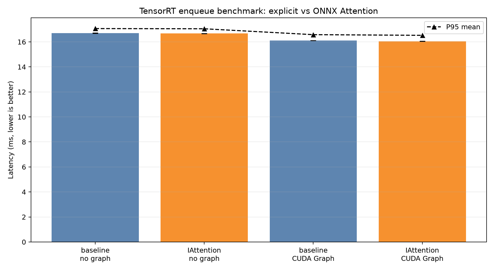
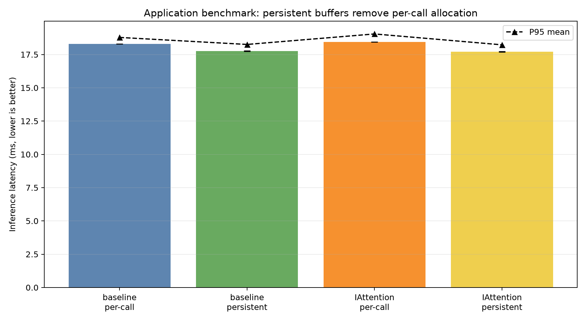
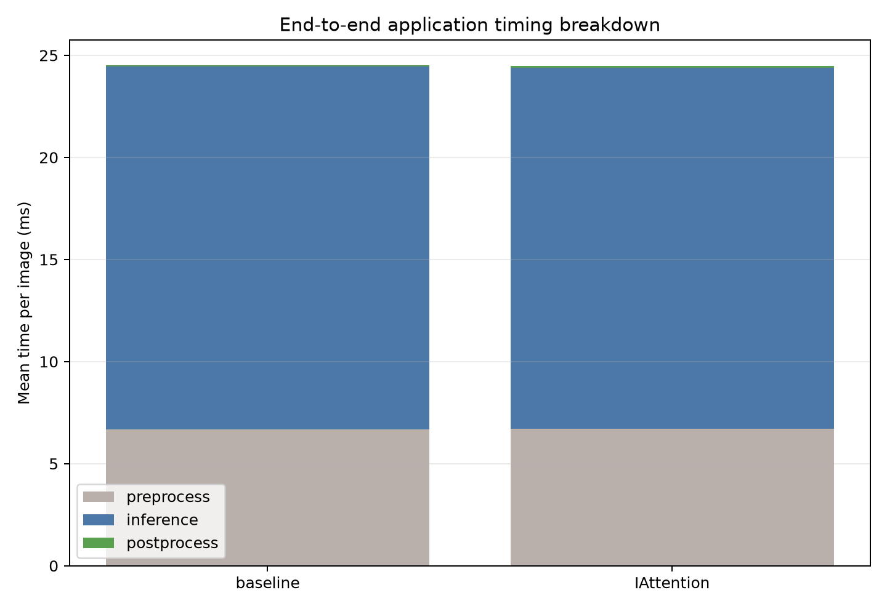

# 阶段二高级优化实验报告

本文记录当前 RF-DETR XLarge 在 encoder attention 和端侧运行时上的第一轮优化实验。实验对象是第一阶段已经完成的组合：**encoder 使用 ModelOpt SmoothQuant、256 张校准图片；decoder 使用当前精度最稳的量化组合；head 保持原精度**。本轮没有重新训练模型，也没有改变 SmoothQuant 的校准范围，唯一的计算图候选是把 encoder 的显式 `QKᵀ → Softmax → AV` 子图改写成 ONNX `Attention`；运行时候选是复用 CUDA stream 和 device buffer。

## 1. 实验问题和对照关系

当前完整 engine 的主要 profile 热点在 encoder。阶段一的 profile 显示 encoder 约占完整计算图 85%，其中 12 个 encoder attention block 的 QKᵀ、Softmax 和 AV 合计约占 60%。因此本轮先验证两个低风险假设：

1. TensorRT 11.4 是否能把显式 attention 识别为真正的融合 kernel。
2. 应用端每次推理创建 stream、`cudaMalloc`/`cudaFree` 是否能通过持久化资源消除。

对照关系如下：

| 名称 | 模型/运行时 | 量化范围 | 本轮作用 |
|---|---|---|---|
| baseline engine | 第一阶段 SmoothQuant 组合 | 保持第一阶段范围；encoder projection 做 SmoothQuant，attention score/Softmax/AV 不新增 INT8，decoder 按当前最优方案，head 保持原精度 | 性能和精度参考 |
| ONNX Attention engine | 在同一 ONNX 上替换 12 个 encoder 显式 attention 子图 | Q/K/V projection 及其既有 Q/DQ 不变；只替换 QKᵀ、scale、Softmax、AV 的图表达；没有把 Softmax 改成 INT8 | 验证 TensorRT 原生 attention 解析/融合 |
| persistent runtime | baseline 或 ONNX Attention engine + C++ 持久资源 | 模型数值不变 | 验证 stream/device buffer 管理开销 |

输入固定为 batch=1、`1×3×700×700`。硬件是 RTX 5060 Ti，TensorRT 11.4.0.106。`trtexec` 只测 GPU enqueue（不包含 H2D/D2H），每组 500 次、200 次 warmup；应用 benchmark 测预处理、推理和后处理，300 次、100 次 warmup。

## 2. ONNX Attention 改写做了什么

脚本 [`rewrite_encoder_attention.py`](rewrite_encoder_attention.py) 找到每个 encoder block 的：

```text
Q/K/V projection → reshape/transpose → scale → MatMul(Q,Kᵀ)
→ Softmax → MatMul(probability,V) → output projection
```

它只删除中间的显式 QKᵀ、Softmax、AV 以及它们的 scale 辅助节点，并创建一个标准 ONNX `Attention` 节点。Q/K/V projection、SmoothQuant 插入的 Q/DQ、output projection、残差和 LayerNorm 都保留。脚本一共改写 12 个 block，并把 ONNX 主 opset 提到 23，因为 `Attention` 算子需要该 opset。

这里的“Attention engine”只表示 TensorRT 成功解析了 `Attention` 节点，**不等于硬件上一定使用了单个 fused attention kernel**。是否真正融合要以 detailed profile 为准。

## 3. TensorRT profile：原生 Attention 没有形成真正的融合收益

### 3.1 数值结果

脚本 [`summarize_stage2_experiment.py`](summarize_stage2_experiment.py) 从 TensorRT detailed profile 生成了本地 `analysis_outputs/attention_fp16_fusion/profile_summary.csv`。profile 的 `averageMs` 是该 layer 在 profile 迭代中的平均 GPU kernel 时间；所有 layer 相加得到的是 profile 总时间，不能与应用端包含拷贝和 host 调度的时间直接等同。

本节的 17.9405/18.1110 ms 来自本轮两个 engine 的同一套 detailed profile JSON；它和阶段一全图 CSV 中记录的 17.5473 ms 不是同一次 TensorRT 构建/测量，不能直接做绝对值对比。这里真正有意义的是 baseline 与候选在同一 profile 条件下的差异，以及 attention 子环节的相对变化。

| profile 指标 | baseline | ONNX Attention | 变化 |
|---|---:|---:|---:|
| 全部 profile layer 时间 | 17.9405 ms | 18.1110 ms | +0.95% |
| 显式 QKᵀ（12 层） | 2.7248 ms | 0（原名消失） | 被内部 GEMM 取代 |
| 显式 AV（12 层） | 3.2624 ms | 0（原名消失） | 被内部 GEMM 取代 |
| Softmax reduction layer | 4.4801 ms | 4.9831 ms | +11.2% |
| `__fc` 内部 GEMM | 0 | 6.1745 ms（24 个） | 仍然是两次 BMM/attention GEMM |

baseline 中的 QKᵀ 和 AV 层名带有 `/attention/attention/MatMul_myl...` 和 `/MatMul_1_myl...`；改写后它们不再保留原名，而是出现在 TensorRT 生成的 `__fc...` 层中。`__fc` 数量为 24，正好对应 12 个 block 的两次 attention 矩阵乘。Softmax reduction 仍然存在，说明 TensorRT 解析了抽象节点，但没有把 QKᵀ、稳定 Softmax 和 AV 合并成一个不可分解的 kernel。

### 3.2 如何读 profile 图



这张图的横轴是四种测试条件：baseline/ONNX Attention 各自分别关闭和开启 CUDA Graph；纵轴是 `trtexec` 的 GPU latency，单位是毫秒，越低越好。柱子的高度是 3 次重复测试的均值，误差线是跨运行的标准差；黑色三角线是每组 P95 的均值。因为每次运行有 500 个 iteration，误差线很小，才能判断不到 1% 的差异是否稳定。

关闭 CUDA Graph 时，baseline 为 `16.6926±0.0191 ms`，ONNX Attention 为 `16.6716±0.0133 ms`，只快 0.13%。开启 CUDA Graph 时，baseline 为 `16.1069±0.0051 ms`，ONNX Attention 为 `16.0501±0.0071 ms`，只快 0.35%。这个差异远小于一次真正 attention kernel 融合应带来的收益，而且 profile 总时间反而上升。因此不能把这一轮结果称为 attention 加速。

CUDA Graph 本身有约 3.5%～3.7% 的收益：baseline 从 16.6926 ms 降到 16.1069 ms，ONNX Attention 从 16.6716 ms 降到 16.0501 ms。但这是 TensorRT enqueue 的调度收益，不是 ONNX Attention 改写的收益。TensorRT 11.4 默认已经启用 CUDA Graph；严格的“关闭”组使用了显式 `--noCudaGraph`，否则容易把两组误标成不同模式。

## 4. Polygraphy 和 COCO 精度验证

### 4.1 Polygraphy 同输入对比

本地 `experiments/attention_fp16_fusion/poly_compare.json` 使用同一个输入缓存，让 baseline 和 ONNX Attention engine 对比输出：

| 输出 | cosine similarity | L2 norm |
|---|---:|---:|
| `dets` | 1.0000000000 | 0 |
| `labels` | 0.9999999957 | 0 |

这说明该改写在当前输出接口上没有引入可见的数值漂移。这里的输入是固定的一组 Polygraphy 输入，不能替代完整数据集评估；它的意义是先排除图改写错误、head layout 错误和输出顺序错误。

### 4.2 COCO 100 张图

| 指标 | baseline | ONNX Attention | 差值 |
|---|---:|---:|---:|
| mAP@[.5:.95] | 0.638222 | 0.638625 | +0.000403 |
| mAP50 | 0.788133 | 0.788695 | +0.000562 |
| mAP75 | 0.702526 | 0.704955 | +0.002429 |
| inference mean | 18.6838 ms | 18.4512 ms | -1.24% |
| inference P95 | 19.3316 ms | 18.9634 ms | -1.90% |

结果来自本地 `experiments/attention_fp16_fusion/coco_baseline_100.json` 和 `experiments/attention_fp16_fusion/coco_100.json`。评估器复用了 TensorRT context 和 device buffer，所以这组应用结果已经不包含每次分配的开销；100 张图的时间差仍可能受 GPU 状态和数据读取影响，不能据此宣布 ONNX Attention 稳定加速。精度上没有异常，说明改写是数值安全的；性能上仍需要以重复的纯 GPU profile 和端侧 benchmark 为准。

## 5. 端侧持久 stream/device buffer 实验

### 5.1 改动

原始 [`tensorrt_infer/src/infer.cpp`](../tensorrt_infer/src/infer.cpp) 的 `infer()` 每次调用都会：

1. 创建 CUDA stream；
2. 为输入和每个输出 `cudaMalloc`；
3. enqueue、拷回结果并同步；
4. `cudaFree` 所有 buffer 并销毁 stream。

本轮新增 `infer_persistent()`：第一次调用时创建 stream、分配输入/输出 device buffer 并绑定 tensor address，后续调用只做 H2D、`enqueueV3`、D2H 和同步。原始 `infer()` 保留为 per-call 对照，因此可以把 runtime 优化的贡献单独测出来。benchmark 的第 7 个参数为 `per_call` 或 `persistent`：

```bash
./tensorrt_infer/build/rfdetr_benchmark \
  <engine> img/000000085772.jpg 300 100 0.5 -1 persistent
```

### 5.2 应用端结果



这张图横轴是模型与 runtime 组合，纵轴是 C++ benchmark 的 inference 时间。inference 包含 H2D、TensorRT enqueue、D2H 和同步，但不包含预处理和后处理。柱高是多次运行均值，误差线是运行间标准差；黑色三角线是 P95。persistent 的收益来自减少 host 端资源管理和 CUDA allocator 调用，模型的 profile kernel 没有变化。

| engine | runtime | inference mean | P95 | 运行间标准差 |
|---|---|---:|---:|---:|
| baseline | per-call | 18.3064 ms | 18.7824 ms | 单次 500 轮 |
| baseline | persistent | 17.7619 ms | 18.2554 ms | 0.0196 ms |
| ONNX Attention | per-call | 18.4460 ms | 19.0437 ms | 单次 500 轮 |
| ONNX Attention | persistent | 17.7059 ms | 18.2267 ms | 0.0255 ms |

相同 engine 内，persistent 使 baseline inference 降低约 0.5445 ms（2.97%），使 ONNX Attention 降低约 0.7401 ms（4.01%）。但两个 persistent engine 之间只差约 0.0560 ms（0.32%），再次说明端到端收益主要来自 buffer/stream 管理，而不是 ONNX Attention 图改写。



该堆叠图的横轴是 baseline 和 ONNX Attention 的 persistent runtime，纵轴是每张图的平均毫秒数。灰色部分是预处理，蓝色部分是 inference，绿色部分是后处理；堆叠柱的总高度是三部分之和。它用于区分“模型计算变快”和“整条应用链变快”：当前预处理约 6.68 ms，远大于后处理约 0.07 ms，因此只优化 attention kernel 不会自动让整条应用延迟同比下降。

## 6. 阶段二当前结论

1. **TensorRT 原生 `Attention` 解析成功，但在当前形状和 RTX 5060 Ti 上没有命中单 kernel fused attention。** 详细 profile 仍然有 24 个内部 attention GEMM 和 Softmax reduction，profile 总时间上升约 0.95%。
2. **ONNX Attention 改写是数值安全的，但不是当前可接受的模型加速方案。** Polygraphy 输出通过，COCO 100 张 mAP 没有下降；纯 TensorRT latency 只改善 0.13%～0.35%，低于工程上应有的收益。
3. **端侧持久化 stream/device buffer 是本轮最明确的可用优化。** 它不改变模型数值，在当前 C++ benchmark 中降低约 3%～4% inference 时间。它仍未包含 pinned host memory 和 CUDA Graph capture，后续可以继续测，但 TensorRT 自己的 CUDA Graph 已经显示主要收益约 3.5%，且不会改变计算热点。
4. **当前阶段二推荐组合**：保留第一阶段 baseline engine，采用 persistent runtime；暂不替换为 ONNX Attention engine。若要继续压缩 encoder attention 的 59.7% profile 时间，应进入定制 fused attention plugin/CUTLASS 或针对固定 `batch=1、heads=12、tokens=1226、head_dim=64` 的 online Softmax kernel，而不是继续依赖 ONNX `Attention` 节点名称。

## 6.1 布局改写实验：`[B,S,H,D]` 没有解锁专用 Attention kernel

为了排除布局导致 TensorRT 不识别融合模式的可能性，第二个图改写版本把每个 encoder block 的 Q、K、V 从原始的 `[B,H,S,D]` 改成 ONNX Attention 常用的 `[B,S,H,D]`，并在输出端转回原图要求的 `[B,H,S,D]`。Q/K/V 投影、SmoothQuant 的 Q/DQ、输出投影、残差和 LayerNorm 都保持不变，只替换 QKᵀ、Softmax、AV 这一段。

实验命令如下，输入模型和默认 BHSd 实验相同：

```bash
conda run -n TensorRT python rewrite_encoder_attention.py \
  --input ../tensort_quant/artifacts_xlarge_smoothquant_256/rfdetr-xlarge-smoothquant-256.onnx \
  --output experiments/attention_layout_bshd/rfdetr-xlarge-attention-bshd.onnx \
  --layout bshd

/home/rton/TensorRT/TensorRT-11.4.0.106/bin/trtexec \
  --onnx=experiments/attention_layout_bshd/rfdetr-xlarge-attention-bshd.onnx \
  --saveEngine=experiments/attention_layout_bshd/rfdetr-xlarge-attention-bshd.engine \
  --skipInference --profilingVerbosity=detailed --builderOptimizationLevel=5 --verbose
```

TensorRT 日志中确实出现了 12 次 `Registering attention`，这只能说明 ONNX parser 识别到了 Attention 节点。随后在 Myelin 生成实现时失败：

```text
Attention operation was not supported by a dedicated kernel.
Alternative, this operation may be marked as decomposable...
Could not find any implementation for node ... FusedAttention
```

这里的“注册”与“可执行实现”是两个阶段。当前 `S=1226` 远大于常见短序列专用 attention kernel 的适用区间，TensorRT 又没有为该形状选择到 dedicated kernel；而这个解析路径没有成功把该节点标记成可分解的普通算子，所以最终 engine 文件为 0 字节，无法进行延迟和精度 benchmark。该失败不是模型数值错误，也不是输出转置错误，而是 TensorRT backend 对该形状/布局没有可用 tactic。

因此，单纯把 BHSd 写法换成 BSHd 不能获得加速，反而暴露了 TensorRT 在此处的构建边界。后续若要真正融合，必须提供自定义 plugin/kernel（内部直接完成 QKᵀ、稳定 Softmax 和 AV），或者把序列切分成 TensorRT 已支持的 tile；只修改 ONNX 节点名称和维度排列是不够的。

## 6.2 自定义 fused-attention plugin 原型

在布局实验之后，进一步实现了一个 `RFDetrFusedAttention` TensorRT plugin。图改写脚本
[`experiments/fused_attention_plugin/rewrite_to_plugin.py`](experiments/fused_attention_plugin/rewrite_to_plugin.py)
把 12 个 encoder block 的 `MatMul → Softmax → MatMul_1` 替换成一个自定义节点；plugin
[`fused_attention_plugin.cu`](experiments/fused_attention_plugin/fused_attention_plugin.cu)
直接接收已经缩放的 Q/K/V，在 GPU 内完成 QKᵀ、online stable Softmax 和 AV，不写出
`[B,H,S,S]` 的 score/probability 中间张量。TensorRT 通过动态 plugin library 的
`getCreators`/`setLoggerFinder` 接口找到该算子，12 个节点均成功注册并构建 engine。

这轮先采用 correctness-first kernel：一个 block 负责一个 `(batch, head, query)`，64 个线程对应 head dimension，thread 0 做 dot reduction 和 online softmax 状态更新。它的价值是验证完整的“ONNX 图替换 → TensorRT plugin 注册 → engine 构建 → 中间张量校验”链路，并为后续换成 warp-level/CUTLASS kernel 提供基线。

### 数值校验

为避免只看最终检测框，额外把第 0 个 plugin 输出标记成 graph output，并与原始 ONNX Runtime 的同名 `MatMul_1_output_0` 对比。两边使用相同 Polygraphy 输入：

| 比较对象 | max absolute error | RMSE | relative L1 | cosine |
|---|---:|---:|---:|---:|
| 第 0 个 encoder attention 输出 | 8.96e-3 | 1.92e-4 | 8.94e-4 | 0.9999999 |

这个结果说明 Q 的 `[B,H,S,D]`、K 的 `[B,H,D,S]` 存储布局和 Softmax 逻辑已经对齐；误差主要来自 TensorRT projection/量化路径与 ONNX Runtime 浮点计算顺序的差异。完整 engine 与当前 baseline engine 的同输入对比为：`labels` cosine 约 `0.9987`，`dets` cosine 约 `0.77`。`dets` 是解码后的坐标，少量 encoder 累积误差会被 sigmoid、box decode 和排序放大，因此该结果还不能作为精度通过。

### 性能校验

在相同 `--noDataTransfers --noCudaGraph` 条件下，原始 baseline 约 `16.7 ms`；当前 plugin engine 约 `255 ms`。慢的原因是参考 kernel 对每个 key 都进行多次 block-wide synchronization，而且 dot 由单个 thread 顺序累加，GPU 并行度和访存复用都很差。虽然它避免了显式的 `S×S` 中间张量，但“少写中间张量”不等于“自动变快”：kernel 设计仍然决定性能。

因此，这个 plugin 目前是**可构建、可执行、第一层数值基本对齐，但不可部署**的诊断基线。下一轮应按以下顺序优化：

1. 用 warp-level reduction 替代 thread 0 的 64 项串行 dot，并把 Q 放入寄存器/共享内存；
2. 对 K/V 按 token tile 加载，减少每个 query 重复读取；
3. 保持 FP32 累加和稳定 Softmax，先确认 profile 收益，再评估 FP16/FP8 或 Q/K 的低精度；
4. 逐层保存 12 个 plugin 输出与 baseline 的 cosine、relative L1、最大值和 Softmax 熵，再进行 COCO 全量评估。

完整构建、运行和限制说明见 [`experiments/fused_attention_plugin/README.md`](experiments/fused_attention_plugin/README.md)。

## 6.3 FlashAttention 实验：先修正布局，再验证真实收益

在 tiled CUDA kernel 之后，进一步把同一个 plugin 的 attention 内核替换为
PyTorch CUDA 的 public `scaled_dot_product_attention` dispatcher。编译时定义
`TORCH_FLASH`，运行时由 PyTorch 根据 FP16 dtype 和固定形状选择 FlashAttention
backend。这里的算法是 FlashAttention 风格的 online softmax：不生成完整
`S×S` score/probability 矩阵，并按 tile 在片上完成归一化和 AV。

### 6.3.1 一个关键的 layout 陷阱

第一版直接调用了底层
`_flash_attention_forward_no_dropout_inplace`。该底层 API 的 CUDA 实现要求
packed 的 `[B,S,H,D]` 语义，而图中 plugin 的张量是 `[B,H,S,D]`。虽然指针和
维度数都能通过 TensorRT 检查，但 kernel 会把 head 维当成 sequence 维，结果第一层
attention 就已经错误：cosine 只有 `0.2561`，RMSE `0.4640`。这说明自定义
attention 不能只检查 shape；必须确认每个维度在被调用 kernel 中的语义。

修正方式是改用 public SDPA dispatcher，并保持 `[B,H,S,D]` 布局。修正后第 0 层
plugin 输出与原始 ONNX Runtime 的 `MatMul_1_output_0` 对比如下：

| 指标 | 修正后的 FlashAttention | 解释 |
|---|---:|---|
| max absolute error | `9.44e-3` | 所有元素中最大的绝对差；受 FP16 rounding 影响 |
| RMSE | `2.07e-4` | 全部 `B×H×S×D` 元素的均方根误差 |
| relative L1 | `9.92e-4` | `sum(abs(candidate-reference))/sum(abs(reference))` |
| cosine | `0.99999947` | 方向几乎一致，说明第一层计算语义已经对齐 |

对照而言，错误 layout 版本的 cosine 只有 `0.2561`，所以这次修正不是微小的
数值调参，而是从错误的维度解释恢复到正确的 attention 计算。

### 6.3.2 全图精度和耗时

实验图由 `rewrite_to_plugin.py --half --torch-flash` 生成。`--half` 只在 12 个
encoder attention 的 Q/K/V 输入和输出边界插入 Cast；projection、SmoothQuant
已有的 Q/DQ、残差、LayerNorm、FFN、decoder 和 head 都没有扩大量化范围。换句话说，
该实验验证的是“FP32 主图 + FP16 FlashAttention 子图”，不是全模型 FP16，也不是
把 Softmax 概率做 INT8 量化。

同一个 Polygraphy 输入下，baseline 与 FlashAttention engine 的最终输出为：

| 输出 | max absolute error | RMSE | relative L1 | cosine |
|---|---:|---:|---:|---:|
| `dets` | `0.989654` | `0.386649` | `0.612590` | `0.773431438` |
| `labels` | `2.52307` | `0.374524` | `0.039740` | `0.998630026` |

随后使用与前一轮相同的 COCO val2017 前 100 张图片进行快速数据集级验证。运行时通过
`LD_PRELOAD` 加载 plugin library，评估器复用一个 TensorRT context 和预分配的
device buffer；因此这组 inference 时间包含 H2D、enqueue、D2H 和同步，但不包含
预处理及后处理：

| 指标 | baseline | SDPA/FlashAttention | 差值 |
|---|---:|---:|---:|
| mAP@[.5:.95] | `0.638222` | `0.635750` | `-0.002472`（-0.247 个百分点） |
| mAP50 | `0.788133` | `0.789513` | `+0.001380` |
| mAP75 | `0.702526` | `0.702813` | `+0.000288` |
| mAP small | `0.403784` | `0.398376` | `-0.005408` |
| mAP medium | `0.678606` | `0.677492` | `-0.001113` |
| mAP large | `0.848437` | `0.840845` | `-0.007593` |
| inference mean | `18.6838 ms` | `9.5952 ms` | `-48.6%` |
| inference P95 | `19.3316 ms` | `10.3679 ms` | `-46.4%` |

结果文件是 `experiments/fused_attention_plugin/coco_sdpa_100.json`。这说明该方案
不是单纯的随机输入误差：数据集 mAP 确实下降了约 0.247 个百分点，尤其 large
目标下降约 0.759 个百分点。若当前项目的精度门限沿用第一阶段约 0.1 个百分点，
该候选暂时不能仅依据 100 张结果直接替换 baseline，因此继续跑完整 val2017。

完整 5000 张结果如下：

| 指标 | baseline SmoothQuant-256 | SDPA/FlashAttention | 差值 |
|---|---:|---:|---:|
| mAP@[.5:.95] | `0.5802505` | `0.5803911` | `+0.0001406` |
| mAP50 | `0.7646492` | `0.7647861` | `+0.0001369` |
| mAP75 | `0.6303462` | `0.6301974` | `-0.0001488` |
| mAP small | `0.3935880` | `0.3937264` | `+0.0001385` |
| mAP medium | `0.6343363` | `0.6351794` | `+0.0008431` |
| mAP large | `0.7560569` | `0.7562465` | `+0.0001896` |

完整结果文件是 `experiments/fused_attention_plugin/coco_sdpa_full.json`。因此在完整
COCO val2017 上，当前 FlashAttention 方案的主指标没有可见下降，100 张结果中的
`-0.247` 个百分点属于子集波动，不能代表全量结论。

`labels` 仍然高度接近，说明分类 logits 的整体方向没有完全破坏；`dets` 的 cosine
明显更低，是因为 box 坐标经过 sigmoid、解码和排序，对 12 层 attention 的小误差
更敏感。这个单输入结果不能代表 COCO mAP，但足以说明当前 FP16 attention 仍需要
逐层误差和数据集评估，不能仅凭第一层 cosine 就直接部署。

纯 GPU `trtexec` 测试使用 `--noDataTransfers --noCudaGraph`，warmup 100 次：

| 方案 | 迭代次数 | mean GPU latency | P95 | 与 baseline 比较 |
|---|---:|---:|---:|---:|
| 第一阶段 baseline engine | 20 | `16.69 ms` | 约 `16.8 ms` | — |
| tiled CUDA plugin | 20 | `108.4 ms` | — | `6.5×` 更慢 |
| PyTorch SDPA/FlashAttention plugin（FP16 attention） | 50 | `8.0309 ms` | `8.5102 ms` | 约降低 `51.9%` |

计算方式为 `1 - 8.0309 / 16.6926 = 51.9%`。这是真正的 attention kernel
收益候选，而不是 ONNX 节点改名带来的 parser 变化；不过它仍是 `trtexec` 的纯
GPU enqueue 时间，不含 H2D/D2H、预处理、后处理和 C++ 应用调度。

### 6.3.3 结果边界和下一步

这条路径有三个工程限制。第一，PyTorch FlashAttention CUDA backend 只接受
FP16/BF16，不能对当前 FP32 plugin 直接调用；FP32 engine 会在运行时报告
`FlashAttention only support fp16 and bf16 data type`。第二，public SDPA
版本需要 `libtorch.so`、`libtorch_cuda.so`、`libc10_cuda.so` 等运行时依赖，
因此 engine 不能脱离 PyTorch 动态库独立部署。第三，当前只完成了 COCO 前 100
张图片验证，尚未完成完整 val2017 的 mAP 和独立生产 runtime benchmark。

因此本实验的阶段性结论是：**FlashAttention 确实可以把当前 encoder attention
路径从约 16.7 ms 降到约 8.0 ms；完整 COCO val2017 上 mAP 从 0.5802505 变为
0.5803911，精度基本保持。当前 FP16 子图和 libtorch 依赖使它仍属于性能验证原型。**
生产化应直接使用 TensorRT/CUTLASS/FlashAttention
兼容的 CUDA kernel，保留 FP32 累加和稳定 Softmax，并按 12 层逐层记录误差、
Softmax 熵、饱和率，再复测 COCO 全量评估。

## 7. 下一轮实验建议

### 7.1 定制 fused attention plugin

plugin 内部完成 QKᵀ、online stable Softmax 和 AV，只写出最终 attention output，不落地完整 logits/probability tensor。当前 tiled CUDA 版本已经完成固定形状验证；PyTorch SDPA 版本已经验证了 FlashAttention 的性能上限候选，但 FP16 输入仍会累积到检测框误差，且依赖 libtorch。下一步应改为不依赖 PyTorch 的 CUTLASS/FlashAttention CUDA kernel，并保留 FP32 累加、最大值归约和指数和累加；完成后再逐层评估是否能安全扩大到 BF16/FP8 或 Q/K/V 的 INT8。

### 7.2 选择性 QKᵀ/AV 低精度

当前 Q/K/V projection 已有 SmoothQuant Q/DQ，但 QKᵀ、Softmax、AV 的低精度还没有做校准实验。下一轮应从“Q/K/V 低精度输入、score/Softmax/累加 FP16”开始，每次只改变一个子路径，并保存每个 attention block 的输出误差、Softmax 熵和饱和率。不要直接把 Softmax 输出插入 INT8 Q/DQ。

### 7.3 运行时的剩余空间

`infer_persistent()` 目前仍使用普通 host `std::vector<float>`，每次同步等待完成；可以继续尝试 pinned host buffer、异步流水和固定地址 CUDA Graph capture。但这些优化应和模型 kernel 优化分开报告，避免把 host 调度收益误算成 attention 加速。

## 8. 产物和复现实验

| 路径 | 作用 |
|---|---|
| [`rewrite_encoder_attention.py`](rewrite_encoder_attention.py) | 12 个 encoder 显式 attention 改写为 ONNX `Attention` |
| [`summarize_stage2_experiment.py`](summarize_stage2_experiment.py) | 解析 trtexec/C++/profile 日志，输出 CSV 和 PNG |
| `experiments/attention_fp16_fusion/build_fused.log` | 本地 TensorRT parser/build 详细日志，可搜索 12 个 `Registering attention` |
| `experiments/attention_fp16_fusion/profile_baseline.json` | 本地 baseline detailed profile |
| `experiments/attention_fp16_fusion/profile_fused.json` | 本地 ONNX Attention detailed profile |
| `experiments/attention_fp16_fusion/poly_compare.json` | 本地 Polygraphy 输出对比 |
| `experiments/attention_fp16_fusion/coco_100.json` | 本地 ONNX Attention COCO 100 张评估 |
| `experiments/attention_fp16_fusion/coco_baseline_100.json` | 本地 baseline COCO 100 张评估 |
| `experiments/fused_attention_plugin/coco_sdpa_100.json` | FlashAttention/SDPA plugin 的 COCO 100 张评估 |
| `experiments/fused_attention_plugin/coco_sdpa_full.json` | FlashAttention/SDPA plugin 的完整 5000 张 COCO val2017 评估 |
| `experiments/fused_attention_plugin/profile_torch_sdpa.log` | FlashAttention/SDPA plugin 的 trtexec 纯 GPU 延迟日志 |
| [`tensorrt_infer/src/infer.cpp`](../tensorrt_infer/src/infer.cpp) | `infer_persistent()` 的持久 stream/device buffer 实现 |
| [`tensorrt_infer/src/benchmark.cpp`](../tensorrt_infer/src/benchmark.cpp) | `per_call`/`persistent` runtime benchmark 参数 |

重新生成本轮汇总图表：

```bash
cd /home/rton/rfdetr
python stage2_advanced_opt/summarize_stage2_experiment.py
```

图表横轴、纵轴、误差线和 profile 的 `averageMs` 含义都在第 3～5 节说明。`analysis_outputs/` 和 `experiments/` 中的大型 engine、ONNX、原始日志和预测结果只用于本地复现，不应作为 GitHub 源码提交。
