# RF-DETR XLarge TensorRT PTQ 最终报告

## 1. 报告目的与最终结论

本报告汇总 RF-DETR XLarge 在 TensorRT 11.4、RTX 5060 Ti 上进行的 PTQ、全量 INT8 敏感性实验、encoder 分组实验、SmoothQuant 实验和 Polygraphy 误差诊断。

最终结论可以概括为：

1. **全量 Conv+MatMul INT8 的主要失败原因是 encoder/attention 的激活量化误差，而不是权重量化误差。** 全量 MinMax 的第一个严重误差出现在 layer 0 的 attention score `QKᵀ`，relative L1=0.6632；后续 attention score 最高达到 2.4912，最终 mAP 从 0.58137 降到 0.12592。
2. **权重本身通常量化得很好。** Encoder projection 的 MinMax/Percentile 权重 relative L1 均值约 0.0108，cosine 约 0.99995，INT8 饱和率约 0.12%。
3. **误差会沿 Transformer 的激活和 residual 路径传播。** Encoder-only MinMax 的上游输入 relative L1 均值为 0.2561，已经大于当前层 Q/DQ 的 0.0910；后层的误差是“上游累计 + 当前层新增误差”的叠加。
4. **Percentile 能降低大多数当前层 activation Q/DQ 误差，但会留下少数尾部敏感层。** 当前实验中平均局部激活误差降到 0.0398，但 block 10 attention output 仍出现上游误差 1.2561。
5. **SmoothQuant 的优势是降低 activation quantization noise，而不是让原始权重保持不变。** 它先做通道级重缩放，将 activation outlier 转移到权重；平滑后权重再进行 INT8 量化时 relative L1 约 0.01985，cosine 约 0.99984。
6. **当前最适合部署的候选是选择性 SmoothQuant 256 张校准版本。** 完整 COCO mAP=0.58025，相对 FP32 只下降 0.00112；TensorRT `trtexec` 纯图推理 16.24 ms，相比 FP32 23.50 ms。

本文中的“全量 MinMax”和“encoder-only MinMax”是不同实验：前者量化所有 Conv 和 MatMul，包括 attention score、AV 和 decoder；后者只量化 encoder 的 72 个 projection MatMul，attention score、Softmax、LayerNorm、残差和 decoder 保持 FP32。

## 2. 实验环境和数据

- 模型：`python_infer/output/rfdetr-xlarge.onnx`
- 输入：`[1, 3, 700, 700]`
- 输出：`dets [1,300,4]`、`labels [1,300,91]`
- 校准数据：COCO val2017，预处理与评测一致
- TensorRT：11.4.0
- GPU：NVIDIA GeForce RTX 5060 Ti，8 GB
- TensorRT Python/Polygraphy 环境：`/home/rton/miniconda3/envs/TensorRT`
- ONNX Runtime/模型导出环境：`/home/rton/miniconda3/envs/torch`
- COCO 评测：5000 张 val2017，`score_threshold=0.0`

原始总报告：[INT8_QUANTIZATION_REPORT.md](INT8_QUANTIZATION_REPORT.md)；分组实验和 PTQ 记录：[PTQ_EXPERIMENT_REPORT.md](PTQ_EXPERIMENT_REPORT.md)。

## 3. 量化策略和实验范围

| 方案 | INT8 范围 | 主要保留 FP32 的部分 | 校准/变换 |
|---|---|---|---|
| 全量 MinMax | 所有 Conv + 所有 MatMul | 归一化、残差、Softmax 等非目标算子 | ORT MinMax，64 张 |
| Conv-only MinMax | Conv | DINOv2/Transformer MatMul、decoder、检测头 | ORT MinMax，64 张 |
| Decoder-only | Conv + DETR decoder MatMul | DINOv2 backbone、归一化、残差、Softmax、检测头 | ORT MinMax，64 张 |
| DINO FFN | encoder FFN fc1/fc2 | attention、decoder 和检测头 | ORT MinMax，64 张 |
| DINO QKV | encoder Q/K/V projection | attention score、AV、FFN、decoder | ORT MinMax，64 张 |
| DINO QKVO | encoder Q/K/V + attention output projection | attention score、Softmax、LayerNorm、FFN、decoder | ORT MinMax，64 张 |
| Encoder MinMax | 12 blocks × 6 projection MatMul，共 72 个 | attention score、Softmax、LayerNorm、残差、decoder | ORT MinMax，64 张 |
| Encoder Percentile | 与 Encoder MinMax 相同 | 同上 | p99.99 activation clipping，8 张 |
| SmoothQuant | DINOv2 encoder Linear 输入/权重 | Conv、decoder、LayerNorm、残差、Softmax、检测头 | ModelOpt SmoothQuant，64/256 张 |

Entropy 和 ORT 内置 Percentile 在当前 XLarge attention 图上会因为直方图校准的内存开销被系统 OOM kill。因此 Percentile 结果使用了 memory-efficient 的 `percentile_clip_encoder.py`：复用 encoder MinMax 的权重 Q/DQ 图，只重新统计 activation p99.99 scale。

## 4. 完整 COCO 精度结果

FP32 baseline 的 mAP@[0.50:0.95] 为 0.581367。

| 方案 | mAP@[.50:.95] | 相对 FP32 绝对变化 | 主要含义 |
|---|---:|---:|---|
| FP32 baseline | 0.581367 | — | 参考 |
| 全量 Conv+MatMul MinMax | 0.125920 | -0.455447 | 失败，只作为敏感性实验 |
| Conv-only MinMax | 0.580038 | -0.001329 | 精度保持最好，但速度收益有限 |
| Decoder-only INT8 | 0.576758 | -0.004610 | decoder 对量化有一定敏感性 |
| DINO FFN INT8 | 0.530314 | -0.051054 | FFN，尤其 fc2，明显敏感 |
| DINO QKV INT8 | 0.581459 | +0.000092 | Q/K/V projection 可量化 |
| DINO QKVO INT8 | 0.581314 | -0.000054 | 加入 attention output 仍基本保持精度 |
| Encoder MinMax，64 张 | 0.529262 | -0.052105 | 72 个 projection 一起量化，激活误差较大 |
| Encoder Percentile，p99.99，8 张 | 0.574184 | -0.007184 | 当前层激活误差降低，但校准数量不同 |
| SmoothQuant，64 张 | 0.579302 | -0.002065 | 选择性 SmoothQuant |
| SmoothQuant，256 张 | 0.580251 | -0.001117 | 当前最平衡的候选 |

完整原始数据位于各 `artifacts_*` 目录的 `coco_int8*.json` 和 `comparison.json`。

## 5. 推理速度和模型大小

### 5.1 应用级 C++ benchmark

单图、预热 50 次、正式迭代 500 次，包含 H2D、TensorRT enqueue、D2H 和当前 C++ 实现的 CUDA 分配。

| 方案 | 推理均值 | 相对 FP32 | engine |
|---|---:|---:|---:|
| FP32 | 26.4743 ms | — | 441.66 MiB |
| Conv-only | 25.7103 ms | -2.89% | 420.60 MiB |
| DINO QKV | 24.4891 ms | -7.50% | 381.72 MiB |
| DINO QKVO | 23.4284 ms | -11.51% | 362.25 MiB |
| SmoothQuant 64 | 18.0908 ms | -31.67% | 202.59 MiB |
| SmoothQuant 256 | 18.8348 ms | -28.86% | 202.71 MiB |

### 5.2 纯 TensorRT 图推理

使用 `trtexec`，关闭 H2D/D2H，启用 CUDA Graph，单 stream，5 秒测试，100 次平均运行。该结果只表示 TensorRT GPU 图执行时间，不是端到端应用延迟。

| engine | 纯图均值 |
|---|---:|
| FP32 | 23.4998 ms |
| SmoothQuant 256 | 16.2378 ms |
| 全量 Conv+MatMul INT8 | 8.06805 ms |

全量 INT8 是速度参考，不是部署方案，因为其 mAP 已经严重失真。

## 6. 全量 MinMax 为什么失败

Polygraphy 分析脚本位于 [analyze_quant_error.py](error_analysis_Conv_MatMul_compare/analyze_quant_error.py)，使用 `ModifyOutputs`、`OnnxrtRunner`、`Comparator`、`StreamingDataLoader` 和 `TrtRunner`。

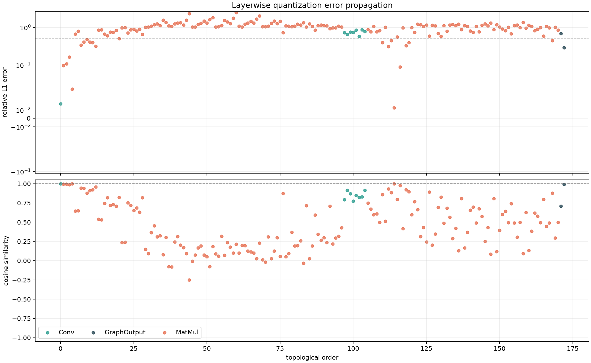

这张图有上下两个面板，横轴都是 **topological order**，即按照 ONNX 图的拓扑顺序给共同输出编号，不是 Transformer 的 block 编号。上方面板的纵轴是 relative L1 error，使用 symlog 坐标：接近 0 的小误差区域按线性方式显示，较大的误差区域按对数方式压缩；虚线是 relative L1=0.5 的排查线。下方面板的纵轴是 cosine similarity，范围约为 -1 到 1，虚线是理想值 1。颜色表示算子类型：青色是 Conv，橙色是 MatMul，深色是最终 GraphOutput。

读图时先找上方面板中第一个越过 0.5 虚线的点，再在下方面板查看同一横坐标的 cosine 是否同时明显下降。若上面误差变大、下面 cosine 仍接近 1，通常是幅值变化；若上面误差变大且 cosine 接近 0 或变成负值，说明特征方向已经被改变，对 attention 和后续残差更危险。当前图中第一个严重点是 order 5 的 layer 0 attention `QKᵀ`，后面橙色 MatMul 长时间维持在高误差区，说明问题沿计算图传播，而不是只发生在最终检测头。

全量图中第一个 relative L1≥0.5 的位置是：

```text
/backbone/.../layer.0/attention/attention/MatMul_1
relative L1 = 0.6632
cosine = 0.6437
```

该节点是 attention score `QKᵀ`，不是最后的检测头。后续 score MatMul 的 relative L1 最高达到 2.4912，cosine 约 0.215，说明注意力分布方向已经明显改变。最终 `dets` relative L1 约 0.697，`labels` relative L1 约 0.284。

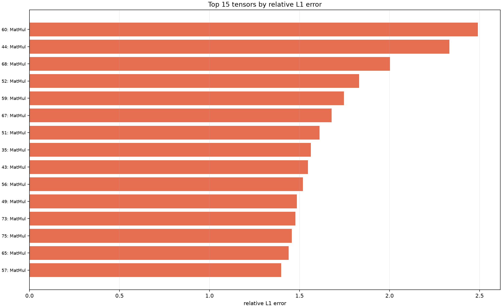

这张图只保留 relative L1 最大的 15 个 tensor。横轴是 relative L1，越向右表示量化输出相对 FP32 的平均幅值偏差越大；纵轴标签由“拓扑序号: 节点最后一段名称”组成，例如 `60: MatMul` 中的 60 是回到上一张传播图定位该节点的索引。条形已经按误差从小到大排列，因此最上方是最严重的节点。颜色仍然对应 Conv、MatMul 或 GraphOutput。它用于回答“最值得优先检查哪些节点”，不能回答“第一个错误在哪里”，因为 Top-15 排序会打乱时间顺序；第一个错误要回到上一张图和 `layerwise_errors.csv`。

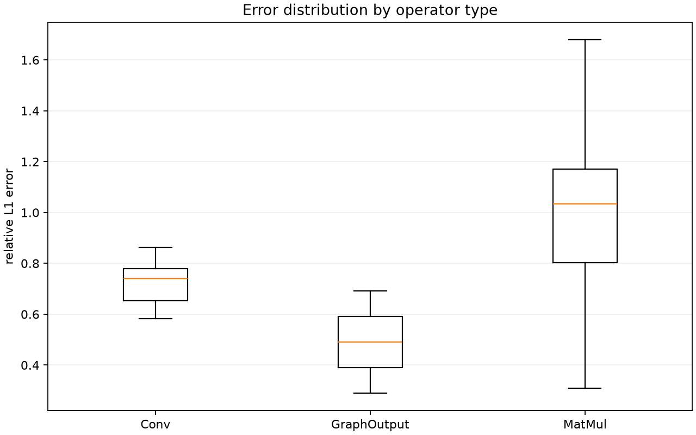

这张箱线图的横轴是算子类别，纵轴是该类别所有输出 tensor 的 relative L1。箱体下边缘和上边缘分别是第 25 和第 75 百分位，橙线是中位数，须表示箱线图的正常范围；脚本设置了 `showfliers=False`，所以极端离群点没有画出来，极端点应到 CSV 中查看。当前 MatMul 箱体整体高于 Conv，表示全量量化的主要问题集中在 MatMul；GraphOutput 只有最终输出的少量点，不能用样本数量与 MatMul 直接比较。箱体高度还表示同一算子类别内部的离散程度：箱体越高，说明不同层对量化越不均匀。

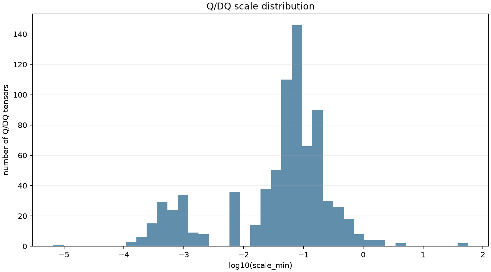

这张图的横轴是 Q/DQ scale 的 `log10(scale)`，纵轴是拥有该 scale 的 Q/DQ tensor 数量。横轴每向右移动 1 个单位，实际 scale 放大 10 倍；scale 越小，理论 INT8 步长越细，scale 越大，步长越粗。峰值表示大量 tensor 使用相近的量化步长，长尾表示少数层的动态范围与主体差异很大。它只能说明量化网格如何分布，不能直接证明某个 scale 一定错误；需要把 scale 的长尾和上面的 layerwise error 在同一拓扑位置对齐。当前图在 `10^-1` 附近有主体，同时存在更小和更大的少数 scale，说明全量 Conv、backbone MatMul 和 attention MatMul 的动态范围差异明显，使用统一的全量量化策略时容易让敏感层得到不合适的有效分辨率。

全量实验的故障链是：

```text
LayerNorm 输出激活量化
→ Q/K/V projection 激活偏差
→ QKᵀ score 偏差
→ Softmax 注意力权重重新分配
→ AV 聚合偏差
→ residual 传递到后续 block
→ decoder 收到失真的 encoder 特征
→ 检测 mAP 大幅下降
```

全量 MinMax 不是“最后一层出了问题”，而是敏感的 attention 计算在早期已经破坏了特征方向。

## 7. Encoder 逐层误差和输入激活诊断

详细报告：[STAGE_REPORT_ENCODER.md](error_analysis_encoder_compare/STAGE_REPORT_ENCODER.md)。

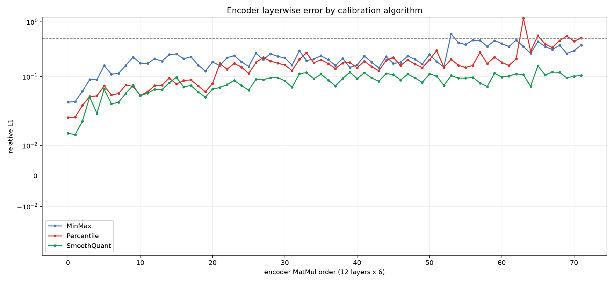

这张图的横轴是 encoder projection order 0～71，每个 block 占 6 个点，固定顺序为 **Q、K、V、attention output、FFN fc1、FFN fc2**；因此 order=8 是 block 1 的 V，order=53 是 block 8 的 FFN fc2。纵轴是 relative L1，同样使用 symlog 坐标，虚线是 0.5。蓝、红、绿分别是 MinMax、Percentile、SmoothQuant。看这张图要区分“整体抬高”和“单点尖峰”：连续多层抬高表示误差已经进入后续 residual 路径，单点尖峰则更像局部 scale 或特定 projection 的问题。当前 MinMax 在 block 0 已经高于 SmoothQuant，block 8～9 明显抬升；Percentile 前半段较低，但 block 10/11 出现尖峰；SmoothQuant 全程更平滑。

Encoder-only 的 72 个 projection 中：

| 算法 | 平均 relative L1 | P95 | 最大值 | 平均 cosine |
|---|---:|---:|---:|---:|
| MinMax | 0.2378 | 0.4553 | 0.6027 | 0.9678 |
| Percentile | 0.1878 | 0.4753 | 1.1584 | 0.9765 |
| SmoothQuant | 0.0818 | 0.1190 | 0.1584 | 0.9967 |

### 7.1 权重误差和激活误差要分开

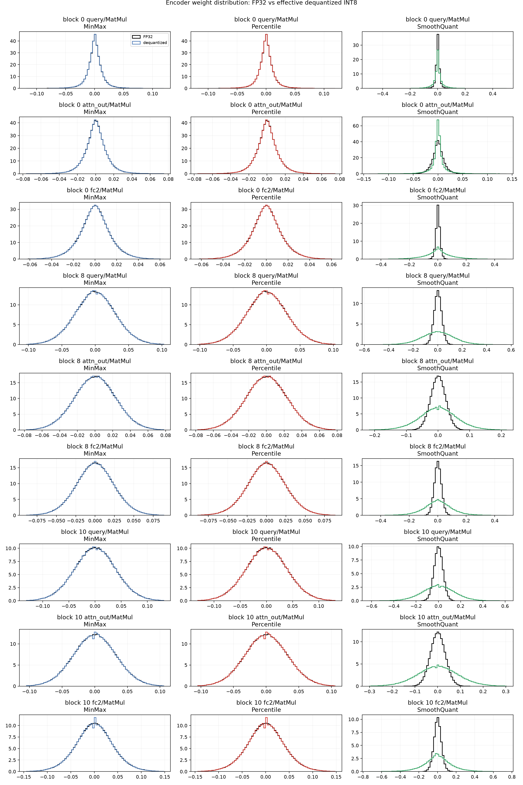

这是一组小 multiples 直方图：每一列是一种算法，每一行是一个代表性 projection。横轴是权重数值，纵轴是归一化密度，不是权重个数；曲线面积约为 1，因此不同子图的峰高只能在同一个子图内比较。黑线是原始 FP32 权重，彩线是量化后再反量化的有效权重。黑线和彩线重合，表示权重的中心、宽度和尾部基本保持；彩线出现阶梯、变宽或尾部缺失，表示 INT8 网格或裁剪改变了权重分布。MinMax 与 Percentile 几乎重合，是因为两者只替换 activation scale，没有重新计算 weight scale；所以不能根据这张图解释 Percentile 为什么改善激活误差。

MinMax/Percentile 的权重直方图基本重合，因为 Percentile 实验只修改 activation scale，没有修改 weight scale。

| 算法 | 权重 relative L1 均值 | 权重 cosine | 饱和率 |
|---|---:|---:|---:|
| MinMax | 0.01083 | 0.999948 | 0.1177% |
| Percentile | 0.01083 | 0.999948 | 0.1177% |
| SmoothQuant | 0.01985 | 0.999838 | 0.1162% |

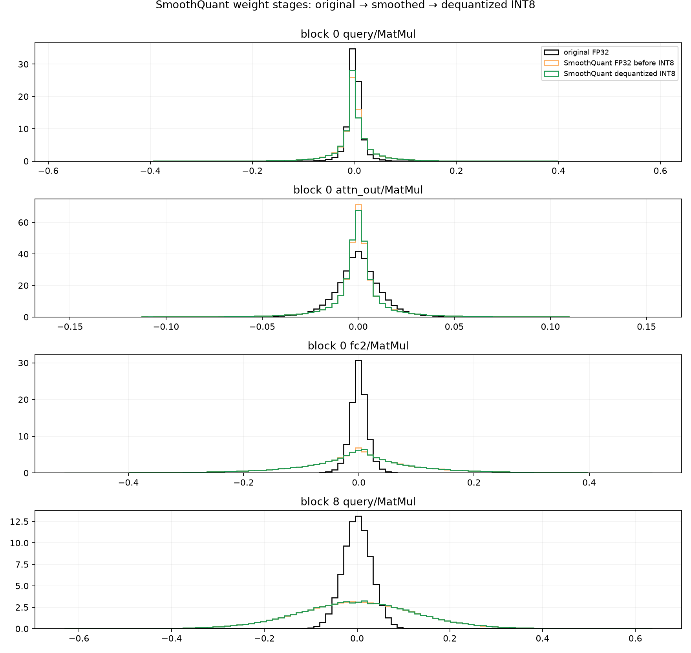

SmoothQuant 的原始权重→平滑权重变化是通道重参数化，不应当直接当作量化损失。真正的平滑后权重→INT8 反量化误差只有约 0.01985。

### 7.2 输入激活误差分解

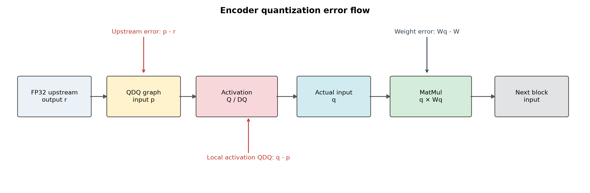

这是误差定义示意图，不是统计曲线。箭头从上游 FP32 输出 `r` 指向当前层 Q 前输入 `p`，再经过 activation Q/DQ 得到真正送入 MatMul 的 `q`。图中 `p-r` 表示误差已经从前面层传过来，`q-p` 表示当前 Q/DQ 新增的误差，`q-r` 才是当前 MatMul 实际接收到的总输入偏差。阅读后面的三联曲线时，分别对应左、中、右三个面板；这样可以把“误差在哪里产生”和“误差在哪里被接收”区分开。

每个 MatMul 的输入被拆成：

```text
r = FP32 输入
p = 量化图中 Q 前输入
q = Q/DQ 后真正送入 MatMul 的输入
```

| 算法 | 上游累计误差 | 当前 Q/DQ 误差 | 有效输入总误差 |
|---|---:|---:|---:|
| MinMax | 0.2561 | 0.0910 | 0.2900 |
| Percentile | 0.2060 | 0.0398 | 0.2169 |
| SmoothQuant* | 0.7508 | 0.0211 | 0.7511 |

SmoothQuant 的星号表示 Q 前输入已经经过通道重缩放，不能直接和原始 FP32 输入逐元素比较；它的局部 Q/DQ 误差才是可比的量化噪声。

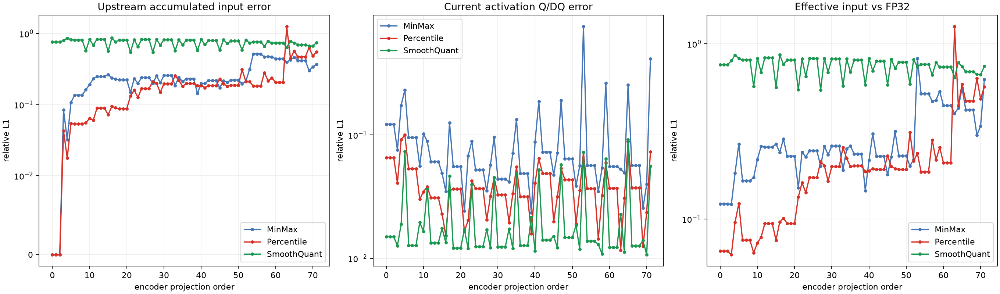

这张三联图必须和下面的直方图一起看。三幅子图横轴相同，都是 encoder projection order 0～71；纵轴都是 relative L1，并使用 symlog 坐标。左图是 `p-r`：当前 MatMul 在 Q 之前收到的输入相对 FP32 输入的偏差，表示上游已经累计的误差；中图是 `q-p`：当前 Q/DQ 新增的局部误差，直接反映当前 activation scale 是否合适；右图是 `q-r`：真正送入 MatMul 的输入相对 FP32 输入的总偏差。颜色仍为 MinMax、Percentile、SmoothQuant。

读图顺序是先看中图，再看左图，最后看右图：中图高说明当前量化器在制造误差；左图高而中图低说明当前层主要是在接收上游误差；右图高则说明 MatMul 实际使用的输入已经明显偏离 FP32。SmoothQuant 左图和右图整体偏高，原因是 Q 前输入已经经过有意的通道重缩放，不能当作普通误差；SmoothQuant 应主要看中图的局部 Q/DQ 噪声。

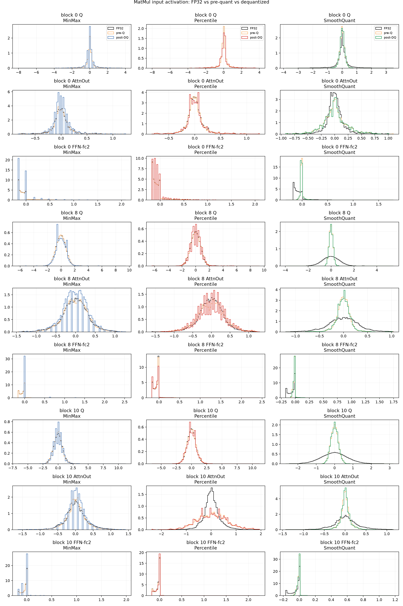

这张图就是上面三联图缺少的“分布证据”。它按行展示 block 0、block 8、block 10 的 Q、attention output 和 FFN fc2 等代表性 projection，按列展示 MinMax、Percentile、SmoothQuant。每个小图的横轴是当前 MatMul 输入激活的实际数值，纵轴是归一化密度；黑线是 FP32 输入，橙线是量化图在 Q 之前的 `pre-Q` 输入，彩线是经过 Q/DQ 后的 `post-DQ` 输入。

具体看法如下：

- **黑线与橙线分离**：误差在当前层之前已经产生，说明是上游 residual、LayerNorm 或前面量化层传下来的；
- **橙线与彩线分离**：当前 Q/DQ 又增加了新的输入误差，优先检查当前层 scale 和 clipping；
- **三条线都重合但形状很宽**：该层本身可能没有明显量化偏差，只是激活动态范围较大；
- **彩线比黑线更窄**：尾部被 clipping 或量化网格压缩；**彩线比黑线更宽**：可能出现量化噪声、尾部放大或 SmoothQuant 重参数化；
- **SmoothQuant 列**：橙线相对黑线整体移动或变窄是设计行为，因为输入通道被除以平滑因子；应比较橙线和彩线之间的距离，而不是直接要求橙线和黑线重合。

例如 block 8 FFN fc2 的 MinMax 图中，彩线出现明显阶梯和尾部偏移，对应三联图中该点的局部 Q/DQ relative L1=0.7572；block 10 attention output 的 Percentile 图中，橙线已经与黑线明显不同，而橙线和彩线相对接近，对应“上游累计误差高、当前 Q/DQ 误差低”的诊断。这个例子说明直方图可以把“误差来自哪里”直观看出来，而不只是给出一个汇总数字。

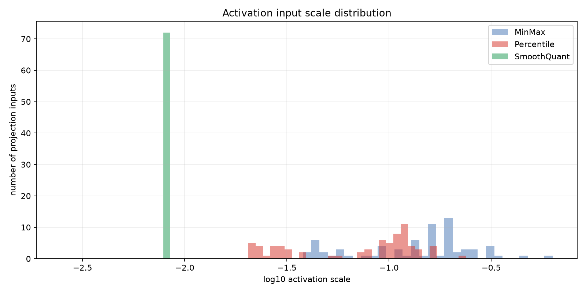

该图横轴是每个 projection 输入的 activation scale 的 `log10`，纵轴是落入该区间的 projection 数量。横轴越靠左表示 scale 越小、INT8 步长越细；越靠右表示动态范围更大、步长更粗。它不是误差直方图，柱子高只表示有多少层使用相近的 scale。比较算法时看分布是否整体左移、是否很宽、是否存在少数远离主体的 scale。MinMax/Percentile 的 scale 范围较宽，说明不同 projection 的输入动态范围差异大；SmoothQuant 集中在更窄的区域，说明通道重缩放后输入更容易使用相近的量化网格。

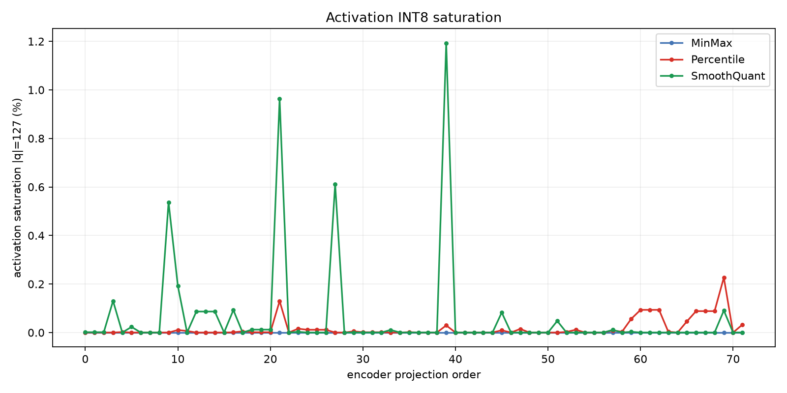

该图横轴仍是 projection order，纵轴是输入激活被量化到 `q=127` 或 `q=-127` 的元素百分比。尖峰表示大量值碰到 INT8 边界，存在 clipping 风险；接近 0 表示没有明显边界饱和，但不代表误差一定小，因为 scale 过大时大多数值会挤在少数量化格点中。图中 SmoothQuant 有少数尖峰，说明平滑后仍有局部 outlier；Percentile 在后层有若干小尖峰；MinMax 饱和率通常较低，但它可能用极端 outlier 拉大 scale，导致非饱和元素的量化分辨率变差。因此饱和率必须和直方图、relative L1 一起读。

MinMax 的上游误差已经大于当前层 Q/DQ 误差，因此主要是误差逐层传递；但 block 8 FFN fc2 的局部 Q/DQ relative L1 仍达到 0.7572，是一个需要保护的局部敏感点。

Percentile 将局部 Q/DQ 平均误差降低到 0.0398，但 block 10 attention output 的上游误差仍达到 1.2561，说明修正当前 scale 不能完全消除之前已经积累的误差。

## 8. SmoothQuant 的机制解释

SmoothQuant 对线性层使用通道级缩放：

```text
y = x Wᵀ
  = (x / s) (W · s)ᵀ
```

- 激活除以 `s`，降低 activation outlier；
- 权重乘以 `s`，吸收动态范围；
- FP32 理论上保持等价；
- 之后再分别进行 INT8 量化。

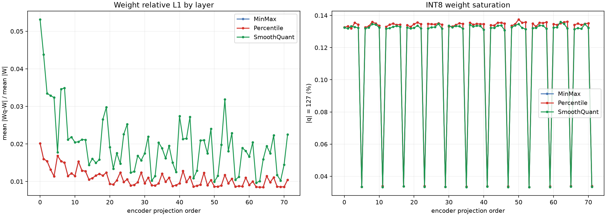

这张图包含两个面板，横轴是同一个 encoder projection order。左图纵轴是权重 relative L1，即 `mean(|Wq-W|)/mean(|W|)`；右图纵轴是 INT8 权重落在 `|q|=127` 的比例。左图用于判断量化后权重幅值是否改变，右图用于判断是否有大量权重撞到量化边界。当前 MinMax/Percentile 左图大多在 0.01 附近且右图约 0.13%，说明权重量化本身较稳定；SmoothQuant 左图更高，是因为其比较对象包含了平滑后的权重重参数化，不能直接解释为“SmoothQuant 权重量化失败”。

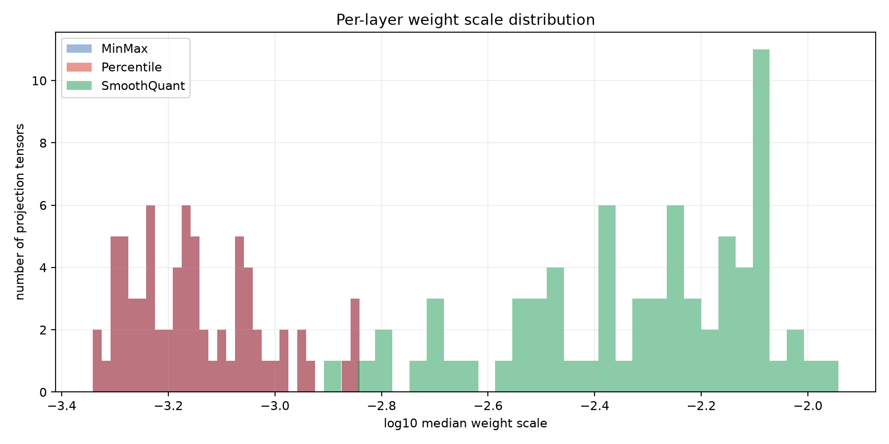

该图横轴是每个 projection 的 median weight scale 的 `log10`，纵轴是 projection tensor 数量。横轴越靠左表示权重 INT8 步长越小，越靠右表示步长越大。柱子重叠表示不同算法对相同层使用了相近的权重量化范围；整体平移表示 scale 被算法系统性改变。SmoothQuant 的柱群相对右移，是因为平滑因子把部分 activation 动态范围转移到了权重；这不是错误，而是 SmoothQuant 的核心重参数化。


这组图的横轴是权重值，纵轴是归一化密度。黑线是原始 FP32 权重，橙线是执行 SmoothQuant 重参数化后、尚未 INT8 量化的 FP32 权重，绿线是最终 INT8 反量化权重。黑线到橙线的差异代表“算法重参数化”，需要和对应的 activation 通道缩放一起看；橙线到绿线的差异才是 SmoothQuant 的实际权重量化误差。block 8 的 FFN fc2 可以看到平滑后分布明显变宽，但绿线仍围绕橙线分布，说明原始分布变化较大并不等于量化误差大。

因此 SmoothQuant 的核心不是让权重分布“保持原样”，而是重新分配 activation 和 weight 的动态范围，使激活更适合 INT8 网格。它最终效果好，是因为激活 Q/DQ 误差降低，同时平滑后的权重仍能被 per-channel INT8 较好表示。

## 9. 部署建议和下一步

当前建议的部署顺序：

1. 优先验证 `artifacts_xlarge_smoothquant_256/` 的完整 COCO 精度和纯图/应用级延迟。
2. 保留 attention score `QKᵀ`、Softmax、LayerNorm、residual、decoder 和检测头为 FP32 或 FP16。
3. 如果要进一步提高速度，优先对 DINO QKV/QKVO 做选择性量化，而不是直接全量量化 attention score。
4. 对 block 8 FFN fc2、后层 V、block 10 attention output 做局部保护实验。
5. 做 weight-only 和 activation-only 消融，验证激活误差的因果贡献。
6. 用同一批 64 或 256 张图片重新跑 MinMax、Percentile、SmoothQuant，形成公平的算法比较。

## 10. 结果限制

- Encoder 中间张量诊断使用同一个 Polygraphy 输入，适合定位传播路径，不等价于 COCO 全量激活分布。
- 三种算法当前校准数量不同：MinMax 64 张、Percentile 8 张、SmoothQuant 256 张，因此 encoder 算法表是阶段性诊断，不是完全公平的最终排行榜。
- SmoothQuant 的重参数化变化必须与输入通道缩放一起解释，不能只比较原始权重和导出权重直方图。
- relative L1、cosine、p99.99 分别反映幅值、方向和尾部；最终部署判断仍以完整 COCO mAP、TensorRT 延迟和稳定性为准。

## 11. 支撑报告

- [INT8_QUANTIZATION_REPORT.md](INT8_QUANTIZATION_REPORT.md)：XLarge 导出、Conv-only 最终方案、速度和精度。
- [PTQ_EXPERIMENT_REPORT.md](PTQ_EXPERIMENT_REPORT.md)：分组 PTQ、QKV/QKVO、FFN、decoder、SmoothQuant 对照。
- [error_analysis_Conv_MatMul_compare/README.md](error_analysis_Conv_MatMul_compare/README.md)：Polygraphy 全量失败定位说明。
- [error_analysis_encoder_compare/STAGE_REPORT_ENCODER.md](error_analysis_encoder_compare/STAGE_REPORT_ENCODER.md)：encoder 权重、激活、输入和分布图详细解释。
