# RF-DETR XLarge Encoder PTQ 阶段性报告

## 先读结论

这份报告要回答的是一个具体问题：**为什么权重直方图看起来几乎没有被破坏，但 encoder 的输出误差会逐层变大？**

阅读时请按下面的顺序区分三种对象：

1. **权重误差**：参数 `W` 从 FP32 变成 INT8，再反量化回 `Wq` 后发生了多少变化；
2. **当前层输入误差**：一个 MatMul 真正收到的输入激活，和 FP32 模型收到的输入激活有多少差异；
3. **层输出误差**：当前 MatMul 和后续算子计算后，输出相对 FP32 偏离多少。

这三个误差不是同一个量。当前实验最重要的结论是：**MinMax/Percentile 的权重误差只有约 1%，但 MinMax 的输入激活误差中位数约 23%，后层的有效输入误差最高约 82%。误差主因是激活量化和上游传播，权重误差是次要项。**

可以把一个量化 MatMul 简化成下面这条误差链：

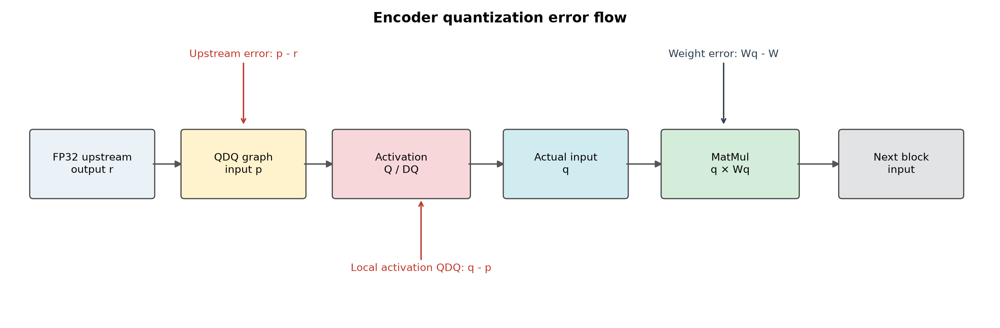

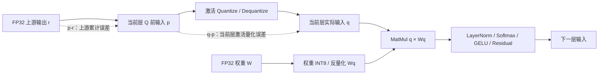

图中的 `p-r` 是“之前已经积累的误差”，`q-p` 是“当前 Q/DQ 新增的误差”。如果只看权重直方图，只能看到 `Wq-W`，看不到 `p-r` 和 `q-p`。

## 实验定义

本报告中的 MinMax 是 **encoder-only MinMax**，不能与 `PTQ_EXPERIMENT_REPORT.md` 中 `artifacts_xlarge/` 的 **全量 Conv+MatMul MinMax** 混称。全量实验量化了 attention score `QKᵀ`、`AV`、Conv、decoder MatMul 等节点；本报告只量化 encoder projection MatMul，保留 attention score、Softmax、LayerNorm、残差和 decoder FP32。

- 模型固定为 `python_infer/output/rfdetr-xlarge.onnx`，输入 `[1,3,700,700]`。
- 只比较 DINOv2 encoder 的 12 个 Transformer block，每个 block 固定量化 6 个 MatMul：Q、K、V、attention output、FFN fc1、FFN fc2，共 72 个节点。
- Conv、LayerNorm、残差、Softmax、decoder、deformable attention、分类头和回归头都保留 FP32。
- 逐层误差通过 Polygraphy 的 `ModifyOutputs` + `OnnxrtRunner` 在同一份输入上读取 FP32/QDQ 中间张量；COCO 精度通过同一 TensorRT evaluator 在 5000 张 val2017 图片上测量。
- FP32 COCO 基线 mAP@[0.50:0.95] 为 0.581367。

### 指标怎么读

| 指标 | 计算方式 | 在本报告中的用途 | 注意事项 |
|---|---|---|---|
| relative L1 | `mean(abs(candidate-reference)) / mean(abs(reference))` | 衡量平均幅值误差 | 参考值接近 0 时会被放大，不能单独作为结论 |
| cosine | `dot(reference,candidate)/(||reference||·||candidate||)` | 衡量特征方向是否保持 | 接近 1 表示方向相同，不能说明幅值完全相同 |
| p99.99 | `abs(tensor)` 的 99.99 分位数 | 观察极少数 outlier 和尾部变化 | 不等于最大值，适合比较尾部而不是平均误差 |
| saturation ratio | `abs(q)==127` 的元素比例 | 判断 INT8 是否发生大范围裁剪 | 低饱和率也不代表没有激活偏差，scale 可能仍过粗 |
| scale | FP32 值对应一个 INT8 步长 | 判断量化网格是否过粗或动态范围是否改变 | SmoothQuant 的 scale 还包含重参数化影响 |

经验上，relative L1 小于 0.05 通常表示该张量在幅值上较接近；0.1～0.3 表示需要结合 cosine 和后续结构判断；超过 0.5 应列为重点诊断对象。但这些是本报告的排查优先级，不是检测模型的通用精度阈值。

## 精度和逐层误差

| 算法 | 校准/变换 | mAP@[.50:.95] | 相对 FP32 | encoder 平均 relative L1 | P95 | 最大值 | 首次 >=0.5 | 平均 cosine |
|---|---|---:|---:|---:|---:|---:|---:|---:|
| MinMax | ORT static PTQ，64 张，INT8 对称激活、per-channel 权重 | 0.529262 | -0.052105 | 0.2378 | 0.4553 | 0.6027 | order 53 | 0.9678 |
| Percentile | p99.99 clipping，8 张，INT8 对称激活、per-channel 权重 | 0.574184 | -0.007184 | 0.1878 | 0.4753 | 1.1584 | order 63 | 0.9765 |
| SmoothQuant | ModelOpt SmoothQuant，256 张，encoder Linear 输入/权重 INT8 | 0.580251 | -0.001117 | 0.0818 | 0.1190 | 0.1584 | 无 | 0.9967 |

MinMax 另有一份 8 张校准复现实验，mAP 为 0.529174，说明这组 encoder 量化对校准集规模很敏感；因此不能把 MinMax 的 64 张和 Percentile 的 8 张结果理解为只由算法造成的差异。下一轮应固定同一批 64/256 张图片后再做最终算法排名。

## 分布角度的诊断

### 1. 先看误差沿 encoder 的位置

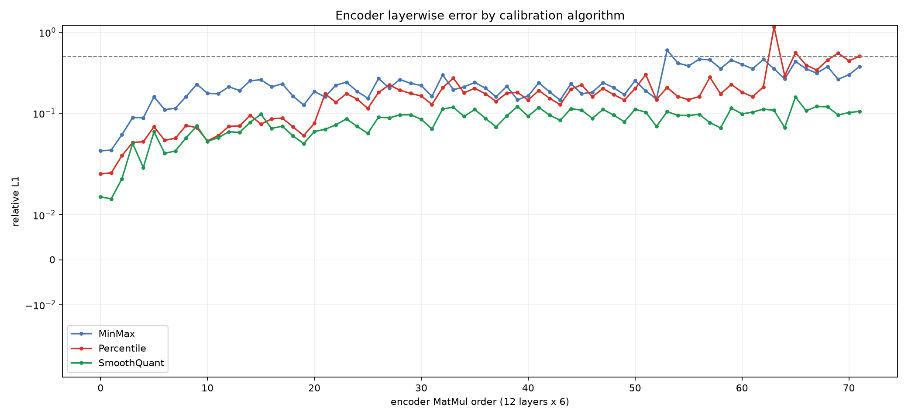

图中横轴是固定的 72 个 projection MatMul 顺序，顺序为每个 block 的 Q、K、V、attention output、FFN fc1、FFN fc2；纵轴是相对 L1 误差。相对 L1 定义为：

```text
mean(abs(INT8 - FP32)) / mean(abs(FP32))
```

它不是激活的绝对误差，也不是 mAP。FP32 激活均值很小的层会出现较大的相对数值，因此必须结合 cosine、p99.99 和最终 mAP 一起判断。

从曲线看，MinMax 的误差在 block 0 已经出现，之后逐层积累；block 9 的平均 relative L1 达到 0.4212、平均 cosine 降到 0.9151，block 8 的 FFN fc2 单层达到 0.6027。Percentile 在 block 0 到 block 9 的平均误差通常低于 MinMax，但 block 10 的 attention output 出现 1.1584 的局部尖峰。SmoothQuant 的每个 block 都保持在较窄范围内，最大值为 0.1584。

**如何读这张图：** 横轴每 6 个点是一个 Transformer block；同一 block 内从左到右依次是 Q、K、V、attention output、FFN fc1、FFN fc2。纵轴使用 symlog，意味着小误差区域近似线性，大误差区域被压缩显示；因此不能用点的垂直距离直接比较 0.1 和 1.0，而应回到 CSV 看精确数值。看曲线时优先观察三件事：曲线从哪个 block 开始抬升、是否连续多层抬升、是否只有一个孤立尖峰。连续抬升更像误差传递，孤立尖峰更像某个局部 scale 或敏感层问题。

按 block 汇总如下，`mean/max` 分别是该 block 六个 MatMul 的平均和最大 relative L1：

| Encoder block | MinMax mean/max | Percentile mean/max | SmoothQuant mean/max |
|---:|---:|---:|---:|
| 0 | 0.0765 / 0.1593 | 0.0373 / 0.0679 | 0.0280 / 0.0590 |
| 1 | 0.1605 / 0.2275 | 0.0550 / 0.0704 | 0.0466 / 0.0694 |
| 2 | 0.2258 / 0.2588 | 0.0796 / 0.0940 | 0.0708 / 0.0969 |
| 3 | 0.1826 / 0.2414 | 0.1133 / 0.1740 | 0.0623 / 0.0850 |
| 4 | 0.2177 / 0.2683 | 0.1724 / 0.2232 | 0.0821 / 0.0956 |
| 5 | 0.2205 / 0.2970 | 0.1916 / 0.2707 | 0.0968 / 0.1184 |
| 6 | 0.1876 / 0.2374 | 0.1679 / 0.1907 | 0.0962 / 0.1209 |
| 7 | 0.1920 / 0.2380 | 0.1772 / 0.2242 | 0.0994 / 0.1137 |
| 8 | 0.2613 / 0.6027 | 0.1950 / 0.2993 | 0.0935 / 0.1117 |
| 9 | 0.4212 / 0.4633 | 0.1908 / 0.2776 | 0.0903 / 0.1154 |
| 10 | 0.3781 / 0.4612 | 0.4264 / 1.1584 | 0.1077 / 0.1584 |
| 11 | 0.3294 / 0.3769 | 0.4469 / 0.5497 | 0.1084 / 0.1212 |

这说明“开始误差累计”不能简单定义为某一个第一坏层：MinMax 是 block 0 开始出现误差，block 8/9 开始明显放大；Percentile 前半段较好，但在 block 10/11 的局部层出现新的尾部敏感点；SmoothQuant 没有出现同等级的突变。

### 2. 按投影类型看哪类层敏感

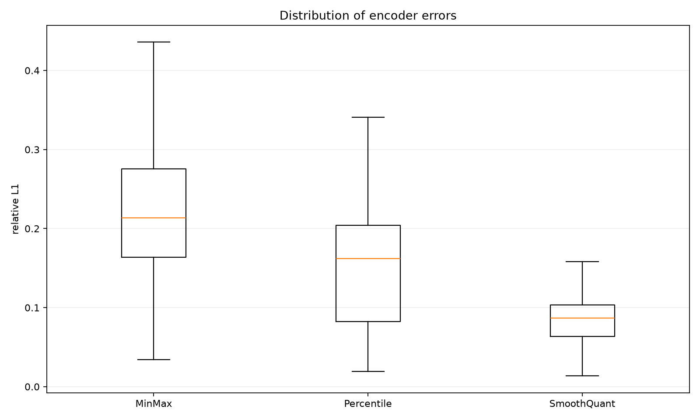

| 投影类型 | MinMax mean/max | Percentile mean/max | SmoothQuant mean/max |
|---|---:|---:|---:|
| Q | 0.2238 / 0.4151 | 0.1453 / 0.3917 | 0.0737 / 0.1072 |
| K | 0.1920 / 0.3833 | 0.1245 / 0.3411 | 0.0678 / 0.1212 |
| V | 0.2677 / 0.4633 | 0.1713 / 0.4530 | 0.0877 / 0.1197 |
| attention output | 0.2261 / 0.4561 | 0.2950 / 1.1584 | 0.0909 / 0.1209 |
| FFN fc1 | 0.2151 / 0.3550 | 0.1700 / 0.4436 | 0.0725 / 0.1017 |
| FFN fc2 | 0.3019 / 0.6027 | 0.2206 / 0.5581 | 0.0985 / 0.1584 |

MinMax 最敏感的是 FFN fc2 和 V；这两个位置会把前面误差继续送入 residual/下一 block。Percentile 的平均值改善最明显的也是 Q/K/V 和 FFN，但 attention output 的最大异常值反而上升，说明 percentile clipping 对整体分布有利，却可能牺牲少数尾部敏感层。SmoothQuant 的所有投影类型都较均匀，没有某一类出现突出的长尾。

**如何读箱线图：** 箱体表示中间 50% 的层，箱体越高说明同类投影的误差离散越大；须和离群点反映少数特殊层。MinMax 的 FFN fc2 箱体和上须更高，说明它不是只有一层偶然异常，而是整体更容易受误差影响。Percentile 的 attention output 平均值不占优，且离群点最高，说明它改善了多数层但没有解决所有尾部层。

完整的按 block、按投影类型数据见 [`encoder_block_summary.csv`](encoder_block_summary.csv) 和 [`encoder_op_summary.csv`](encoder_op_summary.csv)。

三种算法各自的最高误差层如下。这里同时列出 cosine 和 FP32/量化后的 p99.99，用来区分“整体误差偏大”和“单个尾部异常”：

| 算法 | block | 投影 | relative L1 | cosine | FP32 p99.99 | 量化 p99.99 |
|---|---:|---|---:|---:|---:|---:|
| MinMax | 8 | FFN fc2 | 0.6027 | 0.8524 | 6.7226 | 6.6391 |
| MinMax | 9 | V | 0.4633 | 0.8976 | 5.1755 | 4.4952 |
| MinMax | 10 | V | 0.4612 | 0.8889 | 3.2849 | 3.1368 |
| Percentile | 10 | attention output | 1.1584 | 0.8389 | 3.4468 | 4.9624 |
| Percentile | 10 | FFN fc2 | 0.5581 | 0.8707 | 3.6599 | 3.5386 |
| Percentile | 11 | attention output | 0.5497 | 0.9045 | 8.5470 | 10.7256 |
| SmoothQuant | 10 | FFN fc2 | 0.1584 | 0.9894 | 3.6599 | 3.5132 |
| SmoothQuant | 11 | K | 0.1212 | 0.9961 | 8.2939 | 9.0672 |
| SmoothQuant | 6 | attention output | 0.1209 | 0.9934 | 2.2514 | 2.1892 |

Percentile 的第一个异常层很具体：block 10 attention output 的 p99.99 从 3.4468 变成 4.9624，尾部被放大约 1.44 倍，因此它虽然改善了大多数层，却需要把这个层列入保护或重校准候选。SmoothQuant 的最高 relative L1 层仍保持 cosine=0.9894，说明它的误差更多是幅值扰动，而不是特征方向被破坏。

### 3. 看分布尾部，而不是只看平均误差

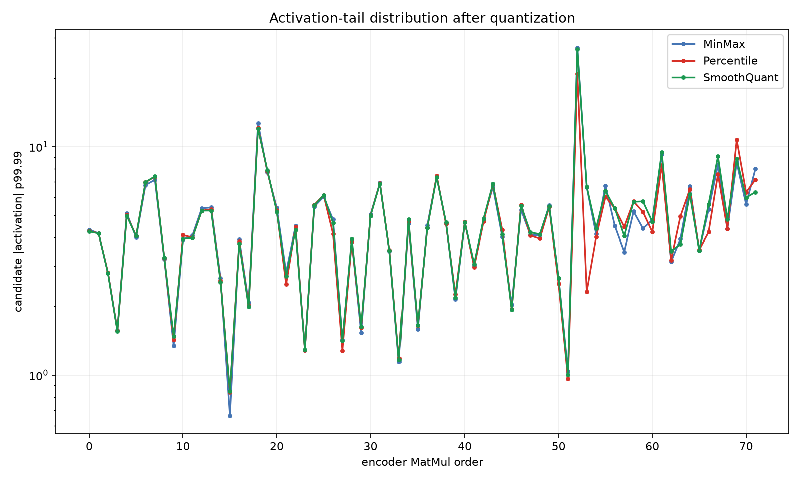

下表中 `candidate/FP32 p99.99` 是量化输出绝对值 p99.99 与 FP32 对应值的比值。它反映尾部能量是否被压缩或放大：

| 算法 | 指标 | 中位数 | P95 | 最大值 | 解释 |
|---|---|---:|---:|---:|---|
| MinMax | relative L1 | 0.2134 | 0.4546 | 0.6027 | 误差在后半段持续累积 |
| Percentile | relative L1 | 0.1620 | 0.4530 | 1.1584 | 平均误差较低，但少数尾部层发生尖峰 |
| SmoothQuant | relative L1 | 0.0870 | 0.1184 | 0.1584 | 分布最集中 |
| MinMax | cosine | 0.9783 | 0.9972 | 0.9994 | 低 cosine 出现在后层敏感投影 |
| Percentile | cosine | 0.9864 | 0.9992 | 0.9998 | 平均方向保持更好，但最差层为 0.8389 |
| SmoothQuant | cosine | 0.9966 | 0.9995 | 0.9999 | 方向偏差最小 |
| MinMax | candidate/FP32 p99.99 | 1.0027 | 1.0858 | 1.3142 | 尾部整体接近，但部分层放大 |
| Percentile | candidate/FP32 p99.99 | 1.0031 | 1.0613 | 1.4397 | clipping 改善主体分布，同时产生局部尾部异常 |
| SmoothQuant | candidate/FP32 p99.99 | 1.0093 | 1.0736 | 1.0975 | 尾部比例最稳定 |


Percentile 的最大 relative L1 为 1.1584，并不与它更高的 mAP 矛盾。mAP 与所有层误差的最大值没有一一对应关系：如果一个异常层位于 residual 后且没有破坏后续 attention 的排序，整体检测结果可能仍然稳定；相反，MinMax 虽然最大值只有 0.6027，但它在 block 0 到 block 9 形成更连续的误差带，平均误差和方向偏差更大，最终 mAP 反而更低。

每个 MatMul 的 FP32/量化分布统计、p99/p99.9/p99.99、绝对误差、RMSE、relative L1 和 cosine 都保存在：

- [`minmax_layerwise_distributions.csv`](minmax_layerwise_distributions.csv)
- [`percentile_layerwise_distributions.csv`](percentile_layerwise_distributions.csv)
- [`smoothquant_layerwise_distributions.csv`](smoothquant_layerwise_distributions.csv)
- [`encoder_distribution_summary.csv`](encoder_distribution_summary.csv)

### 4. 输入激活误差分解：上游累计还是当前层造成

权重分布只能说明参数误差；要判断“输入是否是主因”，还需要把每个 MatMul 的输入拆成三份：

```text
FP32 输入                  = r
量化图中 Q 前输入           = p
量化图中 Q/DQ 后送入 MatMul  = q

上游累计误差     = p - r
当前层 Q/DQ 误差  = q - p
有效输入总误差   = q - r
```

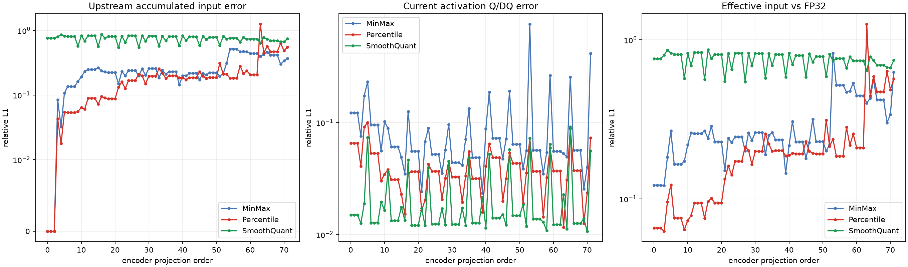

左图是前面层传入当前 MatMul 的累计误差，中图是当前 activation Q/DQ 的局部误差，右图是最终送入 MatMul 的总输入误差。结果如下：

读图时要先看中图，再看左图：如果中图高，当前层的 activation scale 就是主要问题；如果左图高而中图低，当前层只是接收了上游已经发生的偏差；右图则是这两部分叠加后的实际输入状态。三张图中的横轴顺序相同，因此可以在同一个 order 上垂直对照。

| 算法 | 上游累计 relative L1 均值 | 当前 Q/DQ relative L1 均值 | 有效输入总误差均值 | 当前 Q/DQ 最大值 | 当前 Q/DQ cosine 均值 |
|---|---:|---:|---:|---:|---:|
| MinMax | 0.2561 | 0.0910 | 0.2900 | 0.7572 | 0.9966 |
| Percentile | 0.2060 | 0.0398 | 0.2169 | 0.1000 | 0.9994 |
| SmoothQuant | 0.7508* | 0.0211 | 0.7511* | 0.0919 | 0.9996 |

`*` SmoothQuant 的 Q 前输入已经包含 SmoothQuant 的通道重参数化，因此不能直接与原始 FP32 输入逐元素比较；这部分 0.7508 是“重参数化变化 + 上游误差”，不是单纯量化误差。判断 SmoothQuant 的量化噪声，应看中图：局部 Q/DQ relative L1 只有 0.0211，cosine 0.9996。

MinMax 的关键证据是：平均上游误差 0.2561 已经大于当前层 Q/DQ 误差 0.0910，而且 block 8 FFN fc2 的当前 Q/DQ 局部误差也会突然达到 0.7572；因此它是“上游累计为主、个别当前层再放大”的混合模式。MinMax block 9 Q 的上游输入误差达到 0.5164，说明前面 block 的误差已经传入后层。

Percentile 的当前层 Q/DQ 误差均值降到 0.0398，说明 percentile clipping 确实改善了激活量化噪声；但 block 10 attention output 的上游输入误差达到 1.2561，且当前 Q/DQ cosine 仍为 0.99994，说明该异常主要是**前面误差已经传到这里**，不是当前这一层的量化网格导致的。

按 block 的输入误差可以更直观地看到这个转折：

| block | MinMax：上游 / 当前 QDQ / 总输入 | Percentile：上游 / 当前 QDQ / 总输入 | SmoothQuant：当前 QDQ |
|---:|---:|---:|---:|
| 0 | 0.0373 / 0.1413 / 0.1565 | 0.0192 / 0.0716 / 0.0797 | 0.0250* |
| 1 | 0.1655 / 0.0888 / 0.1914 | 0.0568 / 0.0437 / 0.0739 | 0.0185* |
| 2 | 0.2468 / 0.0654 / 0.2611 | 0.0876 / 0.0277 / 0.0926 | 0.0196* |
| 3 | 0.2081 / 0.0579 / 0.2173 | 0.1136 / 0.0314 / 0.1199 | 0.0175* |
| 4 | 0.2294 / 0.0575 / 0.2382 | 0.1778 / 0.0347 / 0.1828 | 0.0186* |
| 5 | 0.2354 / 0.0631 / 0.2476 | 0.2077 / 0.0344 / 0.2124 | 0.0192* |
| 6 | 0.2057 / 0.0742 / 0.2289 | 0.1901 / 0.0360 / 0.1953 | 0.0206* |
| 7 | 0.2081 / 0.0879 / 0.2344 | 0.1940 / 0.0420 / 0.1999 | 0.0212* |
| 8 | 0.2309 / 0.1740 / 0.3221 | 0.2161 / 0.0428 / 0.2233 | 0.0246* |
| 9 | 0.4933 / 0.0870 / 0.5065 | 0.2136 / 0.0360 / 0.2189 | 0.0215* |
| 10 | 0.4361 / 0.0871 / 0.4544 | 0.4815 / 0.0403 / 0.4868 | 0.0271* |
| 11 | 0.3767 / 0.1082 / 0.4214 | 0.5139 / 0.0368 / 0.5175 | 0.0197* |

`*` SmoothQuant 的 Q 前输入经过了通道重缩放，这里只把当前 Q/DQ 新增误差作为可比指标；不能把它的上游/总输入直接与原始 FP32 坐标相减。

**如何读直方图：** 黑线是 FP32 输入，橙线是量化图在当前层 Q 之前收到的输入，彩线是 Q/DQ 后真正送入 MatMul 的输入。黑线和橙线分离，表示误差已经从上游传到当前层；橙线和彩线分离，表示当前层的 activation quantizer 又增加了误差。对于 SmoothQuant，橙线整体移动或拉伸是设计中的通道重缩放，不应当直接判定为失败。

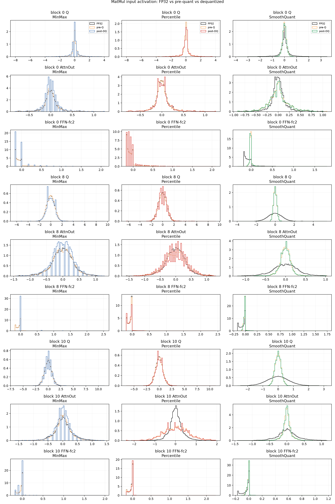

这张直方图是三联曲线的分布层面解释。图按行选择 block 0、block 8、block 10 的代表性投影，按列分别显示 MinMax、Percentile、SmoothQuant。每个小图的横轴是当前 MatMul 输入激活的实际数值，纵轴是归一化密度；黑线是 FP32，橙线是 pre-Q，彩线是 post-DQ。横轴范围由三条曲线合并后的 0.1%～99.9% 分位数确定，因此极少数最大 outlier 可能不在显示范围内；精确 p99.99 请查看 CSV。

读图有三个固定动作：

1. 比较黑线和橙线。两者中心、宽度或尾部不同，说明当前层在 Q 之前就已经收到上游偏差；
2. 比较橙线和彩线。彩线呈阶梯、变窄或尾部消失，说明当前层 Q/DQ 又引入了误差；
3. 看差异位于中心还是尾部。中心附近重合但尾部不同，通常是 outlier/clipping；整条曲线移动或变宽，更像累计误差或 SmoothQuant 重参数化。

MinMax 后层常见的是黑线与橙线先分离，彩线再进一步偏离；Percentile 通常让橙线和彩线更接近，但 block 10 attention output 仍可能因为橙线已经偏离黑线而有较大的总输入误差；SmoothQuant 的橙线整体缩放是设计行为，应关注橙线和彩线之间的局部差异。

`activation_input_scale_distribution.png` 的横轴是 activation scale 的 `log10`，纵轴是使用该 scale 的 projection 数量。横轴左侧表示步长更细，右侧表示步长更粗；分布越宽，说明不同层的动态范围差异越大。`activation_input_saturation.png` 的横轴是 projection order，纵轴是输入激活整数值达到 `|q|=127` 的百分比。尖峰表示大量值撞到边界；曲线接近 0 也不代表误差一定小，因为 outlier 可能把 scale 拉大，使普通值只占很少的 INT8 格点。

输入 scale、饱和率和逐层数据见：

- [`activation_input_layerwise_distributions.csv`](activation_input_layerwise_distributions.csv)
- [`activation_input_distribution_comparison.json`](activation_input_distribution_comparison.json)
- [`activation_input_scale_distribution.png`](activation_input_scale_distribution.png)
- [`activation_input_saturation.png`](activation_input_saturation.png)

### 5. 与全量 Conv+MatMul MinMax 对照

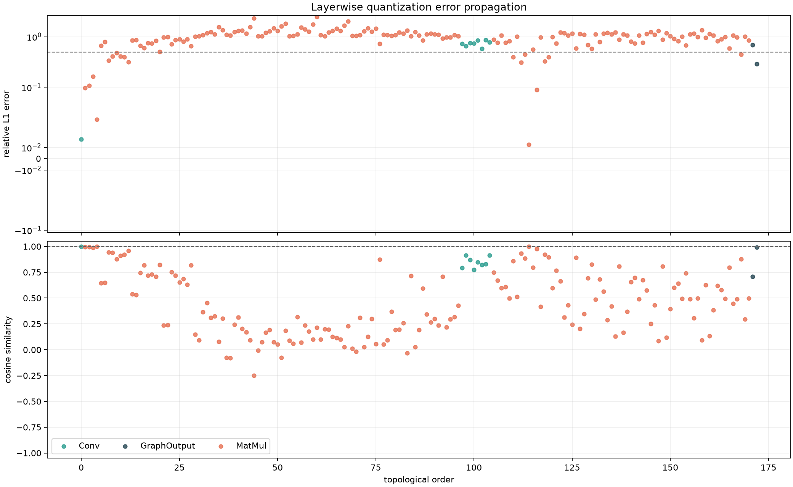

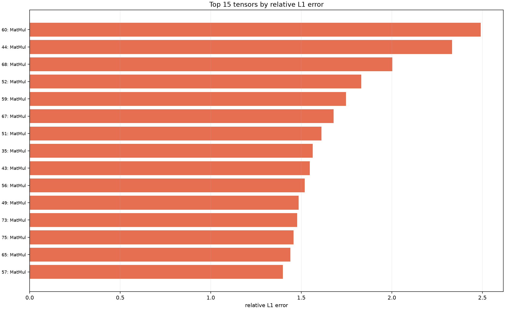

全量 MinMax 的第一个 relative L1 >= 0.5 位于 layer 0 的 attention score `QKᵀ`，数值为 0.6632；后续 attention score 最高达到 2.4912，最终 dets 的 relative L1 为约 0.697。这个节点集合没有包含在本报告的 encoder-only 72 个 projection MatMul 中，因此全量结果不能用来直接否定 encoder-only MinMax 的分布统计。

全量模型的按算子误差和 Q/DQ scale 图仍保存在原分析目录：

- [`error_by_op_type.png`](../error_analysis_Conv_MatMul_compare/plots/error_by_op_type.png)
- [`qdq_scale_distribution.png`](../error_analysis_Conv_MatMul_compare/plots/qdq_scale_distribution.png)
- [`layerwise_errors.csv`](../error_analysis_Conv_MatMul_compare/layerwise_errors.csv)
- [`summary.json`](../error_analysis_Conv_MatMul_compare/summary.json)

### 6. 从分布诊断得到的量化决策

1. **先排除 attention score、Softmax、LayerNorm 和 residual 路径。** 全量 MinMax 的最早严重误差来自 `QKᵀ`，这比单独观察 projection 的权重误差更关键。
2. **FFN fc2 和 V 是 encoder-only 的优先保护对象。** MinMax 中 FFN fc2 平均 relative L1=0.3019，V=0.2677；可先只量化 Q/K，再逐步加入 V、attention output 和 FFN。
3. **Percentile 不能只看平均值。** 它把平均 relative L1 从 0.2378 降到 0.1878，但 layer 10 attention output 出现 1.1584；部署前需要做 per-layer sensitivity 或保留该层 FP16/FP32。
4. **SmoothQuant 的优势是让各层分布更均匀。** 它的 p99.99 比值中位数约 1.009、最大 1.098，relative L1 P95 只有 0.1184；这比单纯把 MinMax 的 clipping 百分位换掉更稳定。
5. **最终算法比较必须固定校准集。** 当前 MinMax 使用 64 张、Percentile 使用 8 张、SmoothQuant 使用 256 张；本报告的数据适合定位分布问题，不能作为完全公平的算法排行榜。

### 7. 下一阶段建议：把相关性验证成因果性

当前分析已经能定位“哪里不正常”，但还没有把每个误差源做成严格的因果消融。建议按下面顺序继续：

1. **权重-only 对照**：保留 activation FP32，只插入 weight Q/DQ；如果输出误差仍然很小，就能确认权重不是主因。
2. **activation-only 对照**：保留 FP32 权重，只插入 activation Q/DQ；将它与当前结果比较，可以直接估计 `ΔxW` 项的贡献。
3. **局部保护实验**：依次把 block 8 FFN fc2、block 9/10 V、block 10 attention output 恢复 FP16/FP32，然后测量 mAP 和逐层误差是否恢复。这样可以验证报告中由分布图提出的敏感层名单。
4. **固定校准集重跑**：让 MinMax、Percentile、SmoothQuant 都使用相同的 64 或 256 张图片，再比较算法；当前 mAP 差异同时包含算法差异和校准集差异。
5. **扩展输入样本**：当前 Polygraphy 中间张量逐层对比使用 `polygraphy_analysis/.inputs.json` 中的同一份输入，适合定位路径，但不代表整个 COCO 激活分布。后续应对多个输入计算每层误差的均值、P95 和最坏样本。

这些实验的判断标准是：如果 activation-only 接近当前误差，而 weight-only 很小，就能把“可能是输入导致的误差”提升为可验证的结论；如果保护某个局部层后 mAP 明显恢复，则该层不仅是统计异常点，也是实际精度敏感点。

## 结果边界

- 权重分布统计覆盖 72 个 encoder projection 的全部参数，结论相对稳定。
- 激活逐层统计覆盖同一输入上的 72 个 MatMul，主要用于定位误差路径；它不是 COCO 全量激活分布估计。
- mAP 使用完整 COCO val2017 的 TensorRT engine 评测，但三种算法的校准图片数量不同，因此当前表格是阶段性诊断结果，不是完全公平的最终排行榜。
- SmoothQuant 的“原始 FP32 → Q 前输入/平滑后权重”包含等价重参数化，不能直接当作普通 Q/DQ 误差；应分别查看重参数化变化和局部 Q/DQ 误差。
- relative L1、cosine、p99.99 分别描述不同方面：幅值、方向和尾部。任何单一指标都不能替代最终 COCO 精度验证。

## 权重分布诊断：量化前、量化后与算法重参数化

前面的图分析的是中间激活输出；本节专门分析权重。对每一个 encoder projection MatMul，脚本从 ONNX 图中取出：

1. FP32 原始权重；
2. INT8 权重及其 per-channel scale；
3. 经过 Q/DQ 反量化后真正送入 MatMul 的有效权重。

因此这里的“量化后权重”不是整数 `q` 本身，而是 TensorRT 实际计算使用的 `q * scale`。统计包括权重直方图、p99/p99.9/p99.99、MSE、relative L1、cosine、scale 范围和 INT8 饱和比例。

### 1. 最直观的权重直方图

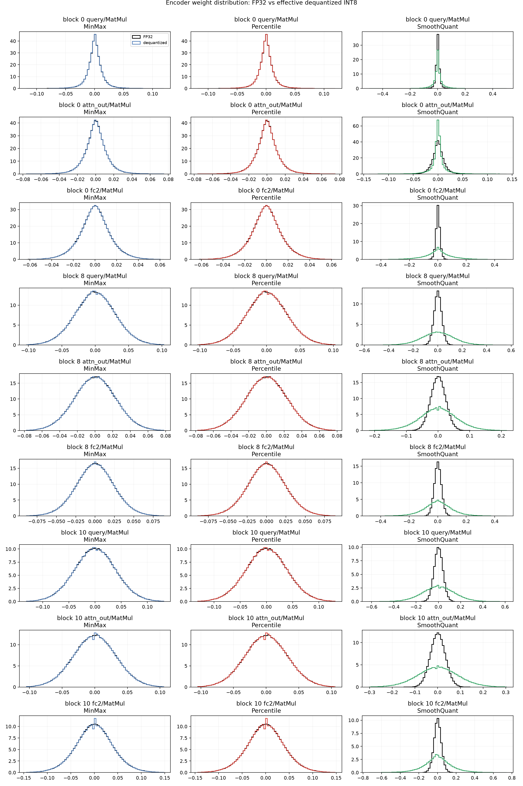

图中黑线是 FP32 原始权重，彩线是三种算法反量化后的有效权重。可以直接看到一个很关键的事实：**MinMax 和 Percentile 的权重量化曲线完全重合。** 这是因为当前 Percentile 实验只替换了 activation scale；两种算法使用相同的权重、相同的 per-channel weight scale 和相同的 INT8 权重。Percentile 与 MinMax 的精度差异来自激活范围，而不是权重分布变化。

每个小图的横轴是该 projection 的权重数值，纵轴是归一化密度，不是参数数量。曲线面积约为 1，因此峰高表示该数值附近权重更集中。先看黑线和彩线的中心位置，再看峰宽和两侧尾部：中心偏移表示整体缩放变化，峰变宽表示动态范围变大，尾部缺失表示裁剪或量化范围不足。SmoothQuant 中黑线与彩线的差异还包含通道重参数化，不能直接等同于纯 INT8 误差。

### 2. 权重本身的量化误差

| 算法 | 权重 relative L1 均值 | P95 | 最大值 | 权重 cosine 均值 | INT8 饱和比例均值 | median weight scale |
|---|---:|---:|---:|---:|---:|---:|
| MinMax | 0.01083 | 0.01540 | 0.02015 | 0.999948 | 0.1177% | 7.44e-4 |
| Percentile | 0.01083 | 0.01540 | 0.02015 | 0.999948 | 0.1177% | 7.44e-4 |
| SmoothQuant | 0.01985 | 0.03348 | 0.05315 | 0.999838 | 0.1162% | 5.39e-3 |

这里 SmoothQuant 的误差是相对于 **SmoothQuant 重参数化后的 FP32 权重**计算的；它的量化后权重 cosine 仍为 0.999838，说明 SmoothQuant 的 INT8 网格本身没有严重破坏权重方向。MinMax/Percentile 的权重误差约 1%，远小于全量实验中 attention score 激活 relative L1 达到 0.66～2.49 的误差。

### 3. SmoothQuant 的核心不是“更精确地还原原始权重”

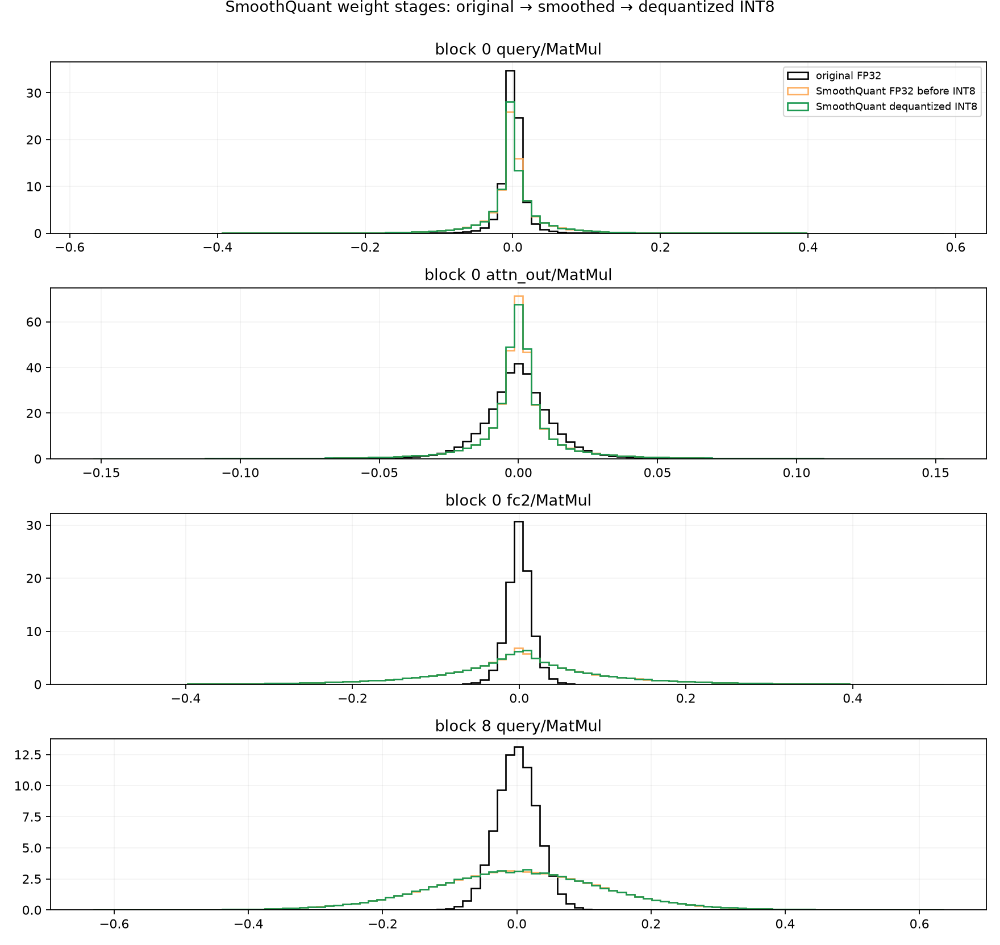

SmoothQuant 会把 activation outlier 通过通道缩放迁移到权重，因此它的“量化前 FP32 权重”已经不是原始模型权重。对比原始 FP32 权重与 SmoothQuant 重参数化后的 FP32 权重：

| 指标 | SmoothQuant 变换结果 |
|---|---:|
| 原始权重 → 平滑后权重 relative L1 均值 | 3.3312 |
| 原始权重 → 平滑后权重 cosine 均值 | 0.9197 |
| 平滑后权重 → INT8 反量化权重 relative L1 均值 | 0.01985 |
| 平滑后权重 → INT8 反量化权重 cosine 均值 | 0.999838 |

这组数字不是说 SmoothQuant 把权重“量坏了”。前一个 3.3312 是算法主动进行的重参数化，必须和输入激活的反向缩放一起看；后一个 0.01985 才是 SmoothQuant 的纯权重量化误差。只看原始权重与最终权重的直方图，会把合法的等价变换误判成量化误差。

### 4. 按投影类型看权重误差

| 投影 | MinMax/Percentile weight relative L1 | SmoothQuant weight relative L1 | MinMax cosine | SmoothQuant cosine |
|---|---:|---:|---:|---:|
| Q | 0.01138 | 0.02358 | 0.999943 | 0.999804 |
| K | 0.01185 | 0.02610 | 0.999938 | 0.999752 |
| V | 0.00972 | 0.01487 | 0.999961 | 0.999900 |
| attention output | 0.00966 | 0.01473 | 0.999961 | 0.999923 |
| FFN fc1 | 0.00979 | 0.02001 | 0.999961 | 0.999831 |
| FFN fc2 | 0.01258 | 0.01981 | 0.999930 | 0.999823 |

MinMax/Percentile 的权重误差在各投影类型之间非常接近；SmoothQuant 的 Q/K 和 FFN 权重变化稍大，因为这些层承担了更多 activation outlier 的迁移。V 和 attention output 的权重量化相对更稳定。

### 5. scale 和饱和分布

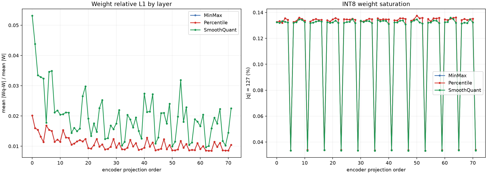

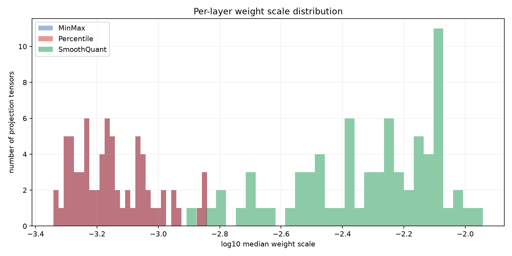

`weight_error_and_saturation.png` 的左图展示 72 个 projection 的权重 relative L1，右图展示 `abs(q)=127` 的比例。三种算法的饱和率都约 0.1%，没有出现大范围权重饱和。`weight_scale_distribution.png` 展示每个 projection 的 per-channel scale 中位数；SmoothQuant 的 scale 整体更大，是由于通道平滑把 activation 的动态范围迁移到了权重。

左图横轴是 projection order，纵轴是 `mean(|Wq-W|)/mean(|W|)`；右图横轴相同，纵轴是权重整数值达到 `+127` 或 `-127` 的百分比。左图看量化后权重离 FP32 有多远，右图看多少权重撞到 INT8 边界。饱和率低但 relative L1 高，说明可能是步长过粗；饱和率高但 relative L1 低，说明主要影响少数极端值。当前三种算法的饱和率都约 0.1%，因此不能用权重大面积裁剪解释精度下降。

`weight_scale_distribution.png` 的横轴是 median weight scale 的 `log10`，纵轴是 projection tensor 数量。横轴向右一个单位代表实际 scale 放大 10 倍；SmoothQuant 柱群右移是把 activation 动态范围迁移到权重的结果。

**如何读权重直方图：** 直方图横轴是权重值，纵轴是归一化后的频率；曲线变宽表示动态范围变大，曲线出现明显偏移表示重参数化改变了通道幅值。判断量化是否破坏权重时，要看 FP32 与反量化曲线是否贴合，而不是看 SmoothQuant 平滑后曲线是否仍和原始权重完全重合。SmoothQuant 的原始→平滑变化是算法操作，平滑→反量化变化才是 INT8 误差。

完整权重数据见：

- [`weight_layerwise_distributions.csv`](weight_layerwise_distributions.csv)
- [`weight_distribution_comparison.json`](weight_distribution_comparison.json)
- [`analyze_weight_distributions.py`](analyze_weight_distributions.py)

### 6. 分布诊断的最终解释

权重分布实验排除了一个容易产生的误判：这次 encoder-only MinMax 的主要问题不是权重整数化本身。MinMax/Percentile 的权重反量化误差约 1%、cosine 接近 1、饱和率约 0.1%，但 MinMax 的中间激活误差仍会在 block 0 开始积累，并在后续层放大。原因是 activation scale、残差传递和 attention/FFN 的敏感性，而不是权重直方图出现了整体崩坏。

Percentile 与 MinMax 的权重分布相同、激活分布不同；SmoothQuant 的权重分布会主动改变，但改变后再量化的权重仍能高保真恢复。直观地说：

- MinMax：权重基本不变，激活范围受极值影响；
- Percentile：权重基本不变，激活尾部被裁剪；
- SmoothQuant：先改变权重通道分布，把 activation outlier 转移到权重，再对平滑后的权重和激活量化。

## Entropy 替代说明

ORT 内置 Entropy 和 Percentile 都需要为大 attention 中间张量建立直方图；本机测试中 Entropy、内置 Percentile 即使 8 张图也被系统 OOM kill。为完成可运行的常用替代算法，本报告的 Percentile 使用 `percentile_clip_encoder.py`：先复用成功的 encoder MinMax QDQ 图和权重，只用同一校准图对 encoder 激活做 streaming p99.99 统计并替换 activation scale。它实现的是标准 percentile clipping，避免 ORT 直方图校准的峰值内存。

复现命令：

```bash
/home/rton/miniconda3/envs/torch/bin/python tensort_quant/quantize_int8.py \
  --calibration-method MinMax --calibration-count 64 \
  --include-pattern '/attention/attention/query/MatMul' \
  --include-pattern '/attention/attention/key/MatMul' \
  --include-pattern '/attention/attention/value/MatMul' \
  --include-pattern '/attention/output/dense/MatMul' \
  --include-pattern '/mlp/fc1/MatMul' --include-pattern '/mlp/fc2/MatMul'

/home/rton/miniconda3/envs/torch/bin/python tensort_quant/percentile_clip_encoder.py \
  --source python_infer/output/rfdetr-xlarge.onnx \
  --minmax-qdq tensort_quant/artifacts_xlarge_encoder_minmax/rfdetr-xlarge-encoder-minmax-int8.onnx \
  --output tensort_quant/artifacts_xlarge_encoder_percentile/rfdetr-xlarge-encoder-percentile-int8.onnx \
  --calibration-count 8 --percentile 99.99
```

需要注意：当前 Percentile 结果是 8 张图，SmoothQuant 是 256 张图，MinMax 主结果是 64 张图；报告已经标注这一限制，下一步应使用完全相同的校准图片清单和数量重新生成三者，然后再做最终结论。
